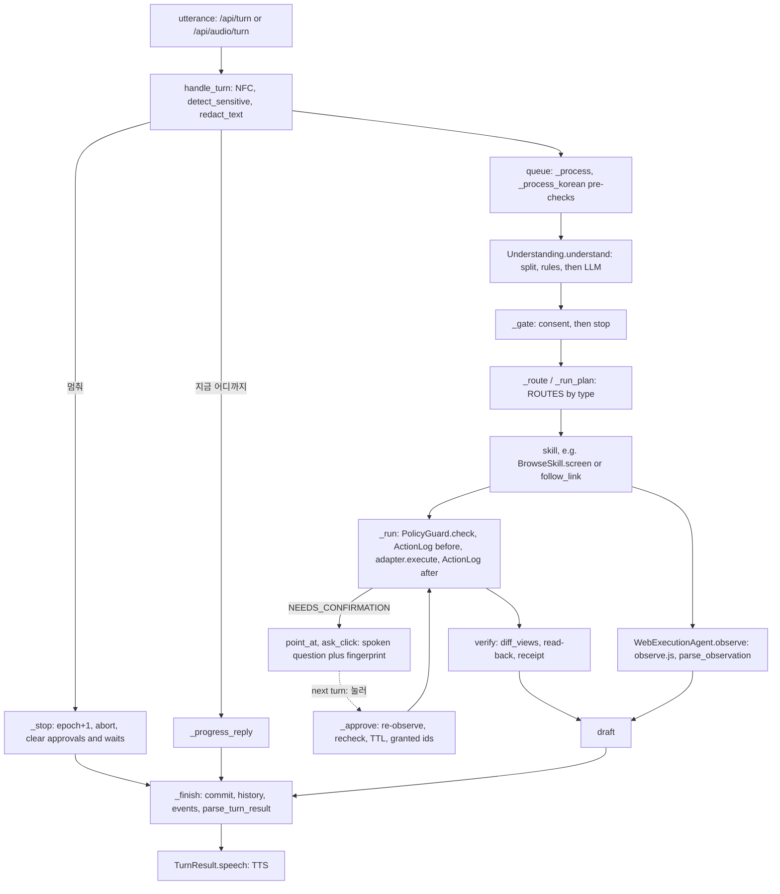

# How 청음 perceives, understands, acts and verifies today

### Overview

청음 runs one loop per utterance: redact the text, understand it as intents, gate on consent and stop, route to a skill, act through one guarded execution path, re-observe, and return a validated `TurnResult` whose `speech` is spoken. Everything a skill knows about the screen comes from one DOM snapshot. `observe.js` runs inside the page and returns the title, fields, errors, dialogs and an outline of clickable items, each with a `ref`, `role` and `name`. There are no pixels and no coordinates anywhere in that path. Nothing in `src/` takes a screenshot, and every LLM call is text only.

The web assumption goes deep. `Observation.url` is required, the guard tiers by URL origin alone, the approval fingerprint is keyed on origin plus path, and `_finish` and `_approve` read `self.web` directly. A screenshot feature adds a perception source beside an existing skill. A desktop feature needs a second execution agent, guard tier source and approval path, and each of those has exactly one hard-wired web implementation today.

### Key Concepts

- **Observation** (`core/actions.py:185`): `{platform: "pc", url, title, fields, errors, dialogs, outline{items[], mainText, …}, capturedAt}`. `InteractiveItem.role` is one of `link|scriptlink|button|tab|menuitem|generic`. The model is loose, so extra keys are ignored.
- **Action** (`core/actions.py:76`): strict (`extra="forbid"`). `type` is one of 10 web verbs (`navigate, back, click, fill, press, select, check, scroll, read, focus`). `risk` is `low|sensitive|consequential`. `ActionTarget` (`:55`) says "좌표 클릭은 계약에 없다". A `ref` must carry `role` and `name`.
- **PolicyGuard** (`safety/guard.py`): `check(action, PolicyContext)` returns `{allowed, code, reason}`. `PolicyContext` holds only `currentUrl, stopped, approvals, actionsThisTurn`.
- **WebExecutionAgent** (`agents/web/agent.py:140`): the only caller of the adapter. Every operation goes through `_run` (`:499`). It returns a `WebOutcome` whose status is one of `ok`, `needs-approval`, `unconfirmed`, `policy-denied` and others.
- **ExecutionAdapter** Protocol (`core/actions.py:217`): `start, execute, observe, close, bring_to_front`. `PlaywrightExecutionAdapter` is the only implementation. Code types it as `Any`, so the Protocol is documentation only.
- **ExecContext** (`agent.py:38`): `signal`, `approvals`, `is_stopped`, `trace`, `counter`. `granted(ids)` adds approval ids for one block.
- **DialogueState** (`core/dialogue.py`): every conversational wait, including the approval slot stamped by the injected clock.
- **`INTENTS`** (`core/intents.py:76`): 37 rows. Intent models, LLM enum, consent allow-list and help text derive from it.
- **`draft()`** (`core/turn.py:361`): the dict every skill returns. `_finish` turns it into a `TurnResult`.

### How It Works

**Entry.** `handle_turn` (`orchestrator/session.py:185`) normalizes to NFC, runs `detect_sensitive` and `redact_text`, and uses only the redacted text afterwards. "멈춰" goes straight to `_stop` (`:275`), which bumps the epoch, aborts the signal, and clears approvals and every dialogue wait. Progress questions go to `_progress_reply`. Both skip the queue. Everything else runs `_process` (`:352`) under an `asyncio.Lock`. `_process_korean` (`:494`) runs ordered pre-checks (secrets, vault, guided fill, personal commands, short replies, multiple and vague questions) before understanding.

**Understanding.** `Understanding.understand` (`understanding/understand.py:51`) splits by rule, then calls `RuleBasedIntentProvider.parse_sync` (`rules.py:152`), an ordered if-chain where the first match wins. If no rule matches, it calls `plan_with_llm`. The LLM fills flat slots that `flat_to_intent` (`llm_planner.py:54`) maps back to params. The LLM cannot produce APPROVE, STOP or PROGRESS. CLAUDE.md lists only the first two. The code and `test_registry.py:56` exclude all three. `_gate` (`session.py:481`) then applies consent and stop. `_route` (`:829`) dispatches through `ROUTES` (`:1210`).

**Perception.** "화면 설명해줘" matches the regex at `rules.py:197` and produces `DESCRIBE_SCREEN`. The route calls `BrowseSkill.screen` (`skills/browse.py:484`), which calls `WebExecutionAgent.observe` (`agent.py:443`). The adapter's `observe` (`browser/__init__.py:566`) evaluates `observe.js` and calls `parse_observation`, and the agent adds `pageId = profile.classify(url)`. For mock pages, or when the user says 자세히/전체/구성, `Narrator.describe_screen` builds the speech from rules alone. Otherwise `Narrator.brief_screen` (`speech/screen.py:200`) runs. A blocked page gets `describe_page`, which ends in `blocked_speech`. Any other page goes to `summarize_body` (`:228`), which sends the redacted title and body to `llm.generate` with `SIMPLE_TEXT_SCHEMA`. It drops the summary if `unsupported_numbers` finds a number above 10 that is not in the raw body. `generate` (`core/llm.py:98`) takes `user: str` and posts `[{system}, {user}]` with strict `json_schema`. It has no image parts.

**Action, approval, execution, verification.** A skill builds an action. For example, `follow_link` (`agent.py:190`) matches the name against `outline.items`, links first, and asks back when several items match. `_run` calls `guard.check` with `currentUrl` from the last view. The guard checks schema, stop, the 12-per-turn rate limit and the action type, then takes the tier (`full`, `read-only` or `none`) from the URL. `_run` writes a "before" row to `ActionLog`, calls `adapter.execute`, and writes an "after" row. `execute` resolves `ref` targets with `_resolve_ref` (`browser/__init__.py:516`), which re-runs `observe.js` and raises `VERIFY_FAILED` if the role or name changed. Then verification: `diff_views` classifies the result as moved, changed or none, fills are read back, and submits wait for the receipt pattern. An approved action with no visible effect returns `unconfirmed`, and the skill asks again.

When the guard returns `NEEDS_CONFIRMATION`, `point_at` (`agent.py:243`) moves focus without clicking. `ask_click` (`browse.py:212`) speaks a question built by code and stores the action with `fingerprint(view, [action], question)`. On "눌러", `_approve` (`session.py:1117`) re-observes through `self.web.observe` and runs `recheck`. If anything differs, it drops the approval and says what changed. If 120 s have passed, it asks again. Otherwise it dispatches on `kind` (`click`, `assist`, or `None` for submit) inside `ctx.granted(ids)`. `_finish` (`:587`) commits state, records events, and calls `parse_turn_result`.

**Seams for (a), an on-demand masked screenshot.** Add an adapter method next to `observe()` and to the Protocol. `self.page` is the handle. Playwright 1.65.2 supports `page.screenshot(mask=[...], style=..., scale="css")`. Let `generate` accept list-shaped `content` with an `image_url` data URL. Add a `LLM_VISION_*` role through `_llm_role` (`runtime.py:96`), because the WEB role may point at a text-only Ollama model. Add a Narrator method beside `summarize_body` and choose it in `BrowseSkill.screen`. Clicks after a description still go through `follow_link` by name.

**Seams for (b), desktop actions.** A new adapter implementing `ExecutionAdapter`, with a `_resolve_ref` equivalent (UIA RuntimeId plus ControlType plus Name). A new agent package, `OrchestratorDeps` field and wiring in `AgentRuntime.create_session` (`runtime.py:250`). A guard tier keyed on app or window identity, a new approval `kind`, and an app-name table modeled on `resolve_site` (`understanding/sites.py:152`). Probed on this PC: `uiautomation` reads the tree (643 ms cold, 29 ms per window), Explorer windows have class `CabinetWClass`, and a minimized window exposes only its title bar. `os.startfile` opens a file without driving Explorer. No Windows automation dependency is installed.

### Constraints a new design must honor

- **Strict `Action`** (`core/actions.py:76`, `extra="forbid"`). An unknown type or field (`windowId`, `coords`) makes `parse_action` return `None`, and the guard returns `DENIED_SCHEMA`. Nothing fails loudly.
- **No coordinates.** `ActionTarget` has no coordinate field. `tests/unit/test_policy.py:50` asserts that `coords` is denied. A `ref` needs `role` and `name` (`:68`). A vision answer can name an item. It cannot become a click target.
- **Strict `TurnResult`** (`core/turn.py`). `ExecutedAction.action` is the web `Action`. `SemanticAction` is a Literal written out twice (`SEMANTIC_ACTIONS` too). `ObservationSummary` requires `page, url, title`. `accessMode` must be `full|read-only|none`. A mismatch raises in `_finish` and the turn ends in RECOVERING.
- **`_finish` reads the browser.** It uses `draft.get("view") or self.web.current_view`, and `_summarize` indexes `view["pageId"]` and `view["fields"]`. A desktop draft without its own view reports the stale web page.
- **URL-derived tier** (`guard.py:116`). `tier_of` reads only the origin. A pseudo-scheme like `uia://explorer` has origin `"null"` (`jsutil.py:110`), so it gets tier `none` and `DENIED_ORIGIN`. Adding `"null"` to `allowedOrigins` would make every non-http URL tier `full`.
- **Risk only goes up.** On tier `full`, a click on a button whose name matches `RISKY_BUTTON` needs approval. On tier `read-only`, any non-input action with `risk != low` is denied outright, not asked (`:169`). The exceptions are `LOGIN_NAME` clicks and `sensitive` inputs with `requiresConfirmation`, which are asked.
- **Approval fingerprint** (`agents/web/approval.py`). It holds origin plus path, each action's type, role, name and current item by ref, value hashes, and the spoken question. It leaves out title and body text on purpose. `_approve` always re-observes through `self.web`. `NOT_DONE` (`session.py:73`) has only three keys, so a new `kind` raises `KeyError`. The TTL is 120 s on `OrchestratorDeps.clock`.
- **Re-check and retry.** `_resolve_ref` raises `VERIFY_FAILED` when the role or name drifts, and a desktop adapter needs the same check. Only a low-risk, unapproved `TIMEOUT` is retried (`agent.py:538`). Anything else returns `unconfirmed` and asks again.
- **Action log** (`personal/action_log.py`). It is hash-chained and sealed. If the "before" write fails for an approved action, `_run` returns `LOG_FAILED` and does not execute. `host` comes from the pre-action URL.
- **Layer table** (`tests/unit/test_layers.py:12`). A new `agents/desktop` becomes layer `agents.desktop` and fails until added to `ALLOWED` and to the `orchestrator` and `server` sets. `agents.web` cannot import `speech.screen`. `core` imports nothing above itself.
- **Intent registry** (`test_registry.py`). It hard-codes 37 rows. Each row needs 2+ examples the rules parse in their stated state, and the first must parse on IDLE, BROWSING and APPLICATION_OPEN. Every type but UNKNOWN must be routed. The LLM enum excludes APPROVE, STOP and PROGRESS. `ALLOWED_WITHOUT_CONSENT` is a literal set.
- **Rule order.** The first match wins. "바탕화면에 뭐 있어?" already gives `DESCRIBE_SCREEN`, because `화면에\s*뭐` matches inside 바탕화면. "다운로드 폴더에 뭐 있어?" gives `READ_DOWNLOAD`. "메모장 열어줘" gives `UNKNOWN`, and with an LLM it becomes a Naver search for "메모장 홈페이지".
- **`redact_text`** (`safety/privacy.py:165`). Every LLM input goes through it. A keyword followed by *any* digit later in the string replaces everything after the keyword with `[비공개]`. Pixels have no equivalent. A screenshot mask can only use DOM anchors.
- **Number verification** (`safety/verify.py:169`). Numbers above 10 in an answer must appear in the text sources. A number that appears only in an image fails, and the summary is dropped.
- **CAPTCHA and bot blocks.** `digest.BLOCKED` checks the title plus the first 600 characters of main text. `blocked_speech` explains and stops. Never bypass a block. Vision must not solve CAPTCHAs.
- **Untrusted screen text.** It never enters intent analysis, and prompts say not to follow on-page instructions. Approval questions are built by code, never by the model.
- **Consent and stop gates** (`safety/gates.py`). Consent is checked per turn, per question, and after `_route` changes the intent. Stop is checked once at turn start. New intents default to `before_consent=False`. Skills must honor `ctx.signal` and `ctx.is_stopped`.
- **Secrets.** Secret fields are always denied, and passwords are never heard or typed. Real submission and identity verification go to the user.
- **Scenarios.** `demo_scenarios.json` must not be modified. `check_expectations` fails on any expectation key it does not know.

### Where Things Live

All paths are under `src/cheongeum/` except the last.
- `core/`: `actions.py`, `turn.py` (contracts), `intents.py`, `llm.py`, `dialogue.py`
- `understanding/`: `rules.py`, `llm_planner.py`, `understand.py`, `sites.py`
- `orchestrator/session.py`: turn loop, `ROUTES`, `_approve`, `_finish`
- `agents/web/`: `agent.py`, `approval.py`, `digest.py`, `effect.py`, `auth_page.py`, `profile.py`; `browser/` (adapter, `observe.js`, `cursor.js`); `skills/browse.py`, `form.py`
- `speech/screen.py` (Narrator); `safety/` (`guard.py`, `gates.py`, `privacy.py`, `verify.py`); `server/runtime.py` (assembly)
- `apps/desktop/main.cjs`: Electron shell. Its preload exposes only `{isDesktop, onTalk}`.

### Gotchas

- `redact_text` often cuts a welfare page to a stub: required-document lists mention 주민등록번호, and digits follow later. Text and vision would get very different privacy treatment.
- Typed name and phone values are in the DOM and on screen. A mask must cover `input, textarea, select`. Cross-origin iframes mask only as whole boxes.
- `observe.js` never enters iframes. reCAPTCHA and embedded viewers show in a screenshot but not in the text.
- The visual cursor (`#__cheongeum_cursor`, z-index 2147483647) would show in screenshots. It uses x/y (`cursor_script`) for display only. `cursor.js` and `browser/__init__.py` have uncommitted peer changes (`__MODE__` replaces `__RIPPLE__`).
- Bug: `auth_page._view_haystack` reads `view.get("mainText")` (`auth_page.py:36`), but `mainText` lives under `outline`.
- `web_answer` does not pass `signal` to `generate` (`browse.py:569`). `LOG_FAILED` is not in `EXECUTION_ERROR_CODES`.
- On tier `full`, only buttons are gated by name. A link named "신청" is low risk.
- No reusable fake adapter exists. E2E tests monkeypatch `s.web.adapter.execute`. `FakeLlm` assumes `user` is a JSON string.
- Open: does `page.screenshot` work on a background tab of headed shared Chrome? Does strict `json_schema` work with image input on the owner's model? How should a vision answer name items so they match `InteractiveItem.name` exactly? What does a restored Explorer list expose (patterns, virtualization)? How long does walking a large window take?
