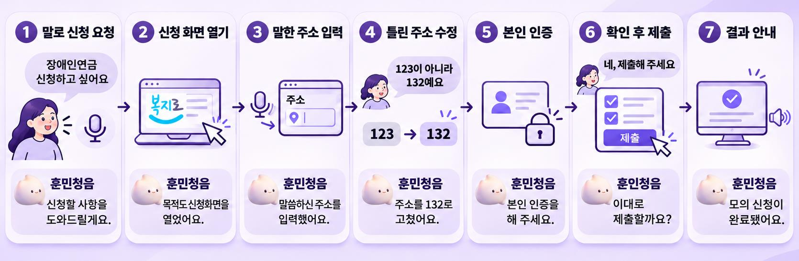

<picture>
  <source media="(max-width: 600px)" srcset="graphics/readme/poster-wordmark.png">
  
</picture>

# 청음 (Cheongeum)


“기초연금을 신청하려면 어디서 시작해야 해?” 청음은 한국의 공공서비스를 이용할 때 화면을 읽고 다음 단계를 찾도록 돕는 PC용 음성 도우미입니다. 기관 이름이나 메뉴 위치를 몰라도 필요한 일을 평소 쓰는 말로 물어보세요. 청음이 찾은 안내를 들은 뒤 “그럼 어떤 서류가 필요해?”처럼 이어서 물을 수 있습니다.

한국어·영어·중국어·일본어로 대화할 수 있습니다. 마이크를 쓰기 어려울 때는 대화 창에 직접 입력하세요.

## 처음 시작하기

**Windows 설치 파일을 받았다면** `Cheongeum-Setup-버전.exe`를 실행한 뒤 시작 메뉴에서 **청음**을 여세요. 설치본에는 브라우저가 포함되어 있습니다. GitHub에 공개된 설치 파일이 없을 때는 아래의 소스 실행 방법을 이용하세요. [릴리스 목록](https://github.com/davemaxuell/voice-welfare/releases) · [소스에서 실행하기](#소스에서-실행하기)

1. 처음 설정에서 대화 언어를 고르세요. 본인이 설정하거나 가족·복지관 직원이 곁에서 도울 수 있습니다. 안내를 들으며 숫자 키로 선택하고 Enter로 진행하세요. Esc는 이전 단계로 돌아갑니다.
2. **OpenAI API 키**를 입력하고 이 PC를 혼자 쓰는지 여러 사람이 함께 쓰는지 고르세요. 소리를 확인하고 듣기 편한 말 빠르기를 선택하세요. 음성 대화와 안내 낭독에는 GPT Live 1.1을 사용하며, 음성·모델 사용량에 따라 API 비용이 발생합니다.
3. 대화 창에서 **대화 시작**을 선택하고 **“장애인연금 연습 신청 도와줘”**라고 말해 보세요. 청음이 첫 번째 입력 칸을 안내합니다. 끝까지 진행하면 연습용 접수번호를 받습니다.

다른 창을 보고 있을 때는 **Ctrl+Shift+Space**로 말할 수 있습니다. 진행 중인 작업을 끝내려면 **“멈춰”**라고 하세요. [설치·음성 설정·단축키 안내](docs/install.md)

### 장애인연금 연습 신청 예시

[](graphics/readme/practice-application.jpg)

사용자가 “장애인연금 신청하고 싶어요”라고 말하면 청음이 신청 화면을 열고 불러 준 주소를 입력합니다. “123이 아니라 132예요”라고 하면 주소를 고칩니다. 본인 인증은 사용자가 직접 하고, 마지막에 제출을 요청하면 청음이 모의 신청 결과를 읽어 줍니다. [훈민청음 포스터 전체 보기 (PDF)](훈민청음_포스터.pdf)

## 이렇게 말해 보세요

| 하고 싶은 일 | 첫 요청과 이어지는 말 | 청음이 하는 일 |
| --- | --- | --- |
| 복지 안내 찾기 | “기초연금 신청 방법 알려줘” → “그럼 어디에 신청해?” | 복지 자료나 공식 안내에서 확인한 내용과 더 확인해야 할 부분을 알려 줍니다. |
| 화면에서 길 찾기 | “복지로 열어줘” → “화면 설명해줘” → “링크 목록 알려줘” | 본문 요점부터 읽고 이동할 수 있는 링크를 안내합니다. 읽어 준 링크는 이름이나 번호로 고를 수 있습니다. |
| 로그인 후 이어가기 | “로그인하고 싶어” → 직접 인증한 뒤 “다 했어” | 로그인 화면을 열고 기다립니다. 입력을 마쳤다고 알리면 하던 일을 이어갈 수 있습니다. |
| 내려받은 안내문 읽기 | “받은 파일 읽어줘” → “받은 PDF에서 신청 기한이 언제야?” | 본문을 읽거나, 사용자가 파일 분석을 승인하면 문서에서 질문에 대한 답을 찾습니다. |
| 신청 기한 기억하기 | “보완 서류는 12월 3일까지래” | 알려 준 기한을 신청 기록에 남깁니다. 개인 PC에서는 나중에 기록을 다시 확인할 수 있습니다. |

도움이 필요할 때는 등록한 보호자에게 연락을 요청할 수 있습니다. 기본 설정에서는 보낼 문자를 미리 봅니다. 실제 발송에는 별도의 문자 서비스 설정과 사용자의 발송 요청이 필요합니다.

## 어떤 정보가 쓰이나요?

- **음성**을 사용할 때는 마이크 입력을 OpenAI로 보냅니다. 비밀번호와 인증번호는 해당 사이트에 직접 입력하세요.
- **화면 설명**은 페이지의 글과 항목 이름을 먼저 확인합니다. 그림이나 차트 해석에 사진이 필요하면 입력란과 감지된 민감정보를 가린 뒤 화면 사진을 OpenAI로 보낼 수 있습니다. 그림 속 개인정보는 남을 수 있습니다. 글만 사용하려면 “사진 없이 화면 설명해줘”라고 하세요.
- **받은 파일**에서 PDF·HWPX 본문은 PC에서 추출합니다. AI 분석을 요청하면 파일 이름과 보낼 곳을 먼저 알려 줍니다. 승인하면 PDF·이미지는 파일 전체를, HWPX는 추출한 본문을 보냅니다.
- **복지 안내**에 쓰는 자료에는 저장된 예시 자료도 있습니다. 공식 API를 연결하면 최신 자료를 조회하고, 연결에 실패하면 저장된 자료를 사용할 수 있습니다. 실제 신청 전에는 해당 기관의 안내에서 대상과 기한을 확인하세요.

## 소스에서 실행하기

Node.js **24 이상**이 필요합니다. 저장소를 내려받은 뒤 루트 폴더에서 실행하세요. 처음 설정을 마치고 음성을 사용하려면 OpenAI API 키를 준비하세요.

```sh
npm ci
npx playwright install chromium
npm start
```

터미널에 서버 주소가 뜨면 브라우저에서 [청음 대화 창](http://localhost:8787)을 여세요. 개발 서버는 웹 화면과 API를 함께 제공하며 [연습용 신청 사이트](http://localhost:5174)도 실행합니다. Electron 창과 전역 단축키를 사용하려면 같은 폴더에서 `npm run start:desktop`을 실행하세요.

### 개발과 검증

| 작업 | 명령 |
| --- | --- |
| 화면을 수정하며 확인 | 개발 서버를 켜 둔 상태에서 다른 터미널로 `npm run dev:web` |
| 타입 검사와 린트 | `npm run typecheck`, `npm run lint` |
| 단위 테스트와 Chromium 통합 테스트 | `npm run test:unit`, `npm run test:e2e` |
| 시나리오 평가 보고서 생성 | `npm run eval` |

개발용 키는 저장소 루트의 `.env`에 `OPENAI_API_KEY`로 설정할 수 있습니다. 복지 API를 사용하려면 `WELFARE_DATA_MODE=official-api`와 `WELFARE_API_KEY`를 함께 설정하세요. `TAVILY_API_KEY`는 공개 자료 검색에 쓰는 선택 설정입니다. 이 키가 없어도 탐색 모델과 브라우저가 설정되어 있으면 공식 사이트에서 자료를 찾을 수 있습니다. [서비스 연결](docs/install.md#서비스-연결하기) · [설치 파일 만들기](docs/install.md#설치-파일-만들기) · [런타임 설정](src/server/runtime.ts)

React 대화 화면과 Electron 앱은 같은 TypeScript 서비스를 사용합니다. 요청이 들어오면 세션이 앞선 대화와 현재 화면을 바탕으로 다음 동작을 정하고, 화면이나 자료에서 확인한 결과를 사용자에게 돌려줍니다. [요청 처리 구조](docs/public-service-agent-architecture.md) · [OpenBot 도입 계획](docs/openbot/implementation-plan.md) · [시각장애인 사용자 테스트 계획](docs/user-test/plan.md)
