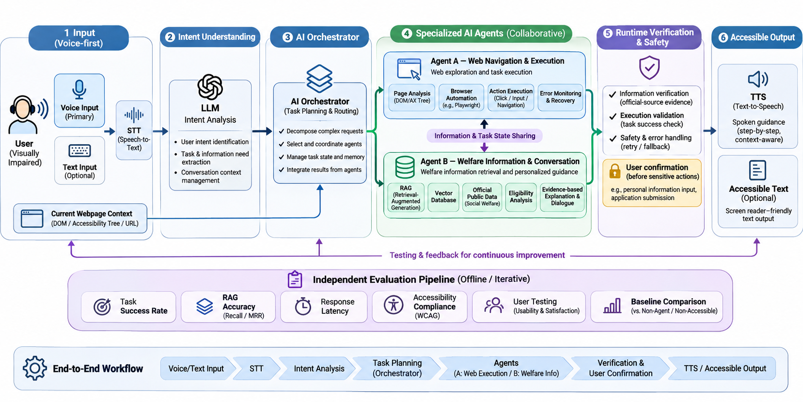

# 청음 · 시각장애인을 위한 공공서비스 음성 에이전트

청음은 시각장애인이 PC에서 말로 웹을 탐색하고 공공서비스 신청서를 작성하도록 돕습니다. 화면에서 찾은 내용을 읽어 주고, 중요한 조작은 먼저 확인합니다. 실제 신청서 제출, 로그인 정보 입력, 본인인증은 사용자가 직접 합니다.

서버와 에이전트는 Node.js에서 TypeScript로 실행합니다. 웹과 Electron 데스크톱 앱은 같은 React 화면을 사용합니다. [아키텍처 그림과 구현 대조](docs/architecture-check.md)



---

## 1. 지금 되는 것 (말 예시)

| 기능 | 이렇게 말하면 | 하는 일 |
| --- | --- | --- |
| **아무 사이트 열기·읽기** | "네이버 열어줘", "화면 설명해줘", "본문 읽어줘", "계속 읽어줘", "링크 목록 알려줘" → "3번", "뒤로 가줘", "이 사이트 뭐야?" | 브라우저로 열고, 메뉴 글자 대신 **본문 요점부터** 짧게 말함. 받아쓰기 오타("네이보", "Naver")도 알아들음 |
| **목표 수행(여러 단계 자동)** | "네이버에서 오늘 주요 뉴스 알려줘", "국민연금공단 사이트에서 고객센터 번호 찾아줘" | 관찰 → 다음 행동 결정 → 실행을 최대 10단계 반복(읽기·이동·검색만). 답은 화면 근거가 확인될 때만 말함 |
| **복지 질문(공식 데이터)** | "기초연금은 몇 살부터 받아?", "그럼 얼마야?", "몇 살부터고 얼마 받아?" | 한국사회보장정보원 공식 API 원문을 근거로만 답함. 없으면 "찾지 못했어요" |
| **맞춤 복지 찾기** | "나한테 맞는 복지 찾아줘" → 나이·장애·소득·지역 → "1번 자세히", "1번 자격 확인해줘" | 중앙(461개)+지자체 목록에서 후보를 찾고 선정기준과 조건별 비교(최종 판정은 안 함) |
| **신청 시작** | "기초연금 신청 도와줘" | 공식 안내 페이지를 열고 요점 한 줄. 본문은 지원 대상 → 서비스 내용 → 신청 방법 순서로 읽음 |
| **실제 사이트 칸 채우기** | "입력 칸 하나씩 채워줘" → "홍길동" / "응" / "건너뛰기" / "그만" | 칸을 하나씩 묻고 넣은 뒤 화면 값을 다시 읽어 확인. 비밀번호·인증·동의 칸 제외, **제출 버튼은 누르지 않음** |
| **개인 정보 금고** | "내 이름은 김하늘이고 주소는 …라고 저장해줘", "내 정보 알려줘/지워줘" | 확인 후 이 컴퓨터에만 저장(이름·주소·연락처·이메일·생년월일만) |
| **신청 후 추적** | "기초연금 신청했어, 접수번호는 …", "보완 서류는 12월 3일까지래", "신청한 거 어떻게 됐어?" | 신청·기한을 기억, 기한 3일 전부터 알림 |
| **로그인 인계** | "로그인 눌러줘, 그 뒤는 내가 할게" | 로그인 페이지 링크까지만 열고 사람에게 넘김 |
| **연습용 신청서** | "장애인연금 연습 신청 도와줘" | 모의 신청서에서 입력·검증·요약·승인 후 모의 접수(실제 전송 없음) |
| **다국어** | "영어로 말해줘", "Speak English", "说中文", "日本語で話して", "Korean please" | 그 언어로 듣고 답함(LLM 필요). 한국 고유 용어는 원어와 짧은 풀이 |
| **멈춤·대화 습관** | "멈춰"(stop/停止/止めて), "알았어", "아니", "쉽게 말해줘" | 멈춤은 무엇보다 먼저 즉시. 맞장구·부정은 입력값으로 넣지 않음 |

## 2. 빠른 시작

### 브라우저로 실행하기

Node.js 24 이상과 npm을 설치한 뒤 저장소 루트에서 실행하세요. API 키 없이 규칙 기반 명령과 샘플 복지 데이터를 쓸 수 있습니다.

```bash
npm ci
npx playwright install chromium
npm start
```

`npm start`는 React 화면을 `dist/web/`에 빌드하고 서버를 시작합니다. 브라우저에서 [청음 웹 화면](http://localhost:8787)을 여세요. **안내 듣고 시작하기**에서 동의한 뒤 “장애인연금 연습 신청 도와줘”를 입력해 보세요. 기본 서버는 연습 사이트도 5174번 포트에 엽니다. 연습 사이트만 실행하려면 `npm run mock`을 사용하세요.

UI를 편집할 때는 서버를 켜 두고 다른 터미널에서 `npm run dev:web`을 실행하세요. 터미널에 표시된 Vite 주소로 접속하면 화면 변경이 바로 반영됩니다. API 키와 사용하려는 공급자는 루트의 `.env`에서 설정하고 서버를 다시 시작하세요.

### 로컬 한국어 받아쓰기 설정하기

한국어 음성을 이 컴퓨터에서 받아쓰려면 Python 3.12 이상과 uv를 설치하세요. 아래 명령은 Python 환경을 준비하고, 처음 한 번 학습 모델을 내려받아 `models/`에 저장합니다.

```bash
uv sync --project python
npm run setup-models
```

루트의 `.env`에 다음 값을 넣고 서버를 다시 시작하세요.

```dotenv
STT_PROVIDER=local
STT_LOCAL_MODEL=models/whisper-small-komixv2-ct2
PII_MODEL=models/koelectra-ko-pii-ner
```

로컬 한국어 모델은 녹음을 컴퓨터 안에서 처리합니다. 외국어 음성을 OpenAI에서 받아쓰려면 `STT_MODEL`과 음성 API 키도 설정하세요.

### 데스크톱에서 단축키로 말하기

루트에서 `npm ci`와 Chromium 설치를 마친 뒤 다음 명령을 실행하세요.

```bash
npm --prefix apps/desktop ci
npm --prefix apps/desktop start
```

음성 대화에는 서버 받아쓰기가 필요합니다. 위의 로컬 모델이나 `STT_PROVIDER=openai`를 설정하세요. 청음은 트레이에서 동의 안내를 읽습니다. Windows에서는 **Ctrl+Shift+Space**, macOS에서는 **Cmd+Shift+Space**로 동의하고 말할 수 있습니다. 데스크톱은 실제 사이트 모드로 시작합니다. 창을 보려면 시작 전에 `CHEONGEUM_SHOW_WINDOW=1`을 환경 변수로 설정하세요. 연습 사이트로 시작하려면 `.env`에 `PRACTICE_MODE=true`를 넣으세요.

Electron은 `CHEONGEUM_NODE` 또는 `PATH`의 `node`로 `src/server/main.ts --desktop`을 실행합니다. 트레이 메뉴의 **청음 종료**를 선택하면 자식 서버와 브라우저 세션도 닫힙니다. [설치 및 빌드 안내](docs/install.md)

<details>
<summary>그 밖의 설정(.env)</summary>

| 변수 | 기본 | 설명 |
| --- | --- | --- |
| `LLM_PROVIDER`, `LLM_MODEL`, `LLM_API_KEY`, `LLM_BASE_URL`, `LLM_REASONING_EFFORT` | `mock` | `openai` / `ollama`(로컬 Qwen) / `qwen`·`openai-compatible`. 모델 ID는 코드에 없음 |
| `STT_PROVIDER`, `STT_MODEL`, `STT_BASE_URL` | `mock` | `openai` 또는 `local`. `local` + `STT_BASE_URL` = OpenAI 호환 로컬 받아쓰기 서버, `local` + `STT_LOCAL_MODEL` = 로컬 Python 프로세스(faster-whisper) |
| `STT_LOCAL_MODEL`, `STT_LOCAL_THREADS`, `STT_LOCAL_BEAM`, `STT_LOCAL_PROMPT` | —, `0`(자동), `1`, `false` | 한국어는 로컬 모델, 다른 언어는 OpenAI(`STT_MODEL`과 키가 있을 때, 없으면 로컬). 모델이 없으면 서버 받아쓰기를 끔(OpenAI로 몰래 보내지 않음) |
| `PII_MODEL`, `PII_THRESHOLD` | —, `0.5` | 로컬 개인정보 인식 모델 폴더. 민감정보 판정 = 규칙 ∪ 모델(비밀번호·주민번호·계좌·카드·신분증 번호) |
| `TTS_PROVIDER`, `TTS_MODEL`, `TTS_VOICE`, `TTS_SPEED`, `TTS_INSTRUCTIONS` | `mock` | `openai` 또는 `browser`(무료 OS 음성) |
| `WELFARE_DATA_MODE`, `WELFARE_API_KEY`, `WELFARE_API_BASE_URL` | fixture | `official-api`면 공식 API(실패 시 fixture) |
| `PRACTICE_MODE` | 서버 `true` / 데스크톱 `false` | `false` = 실제 사이트 모드 |
| `CHEONGEUM_DATA_DIR` | 데스크톱 `~/.cheongeum` | 금고·신청 기록과 조작 기록. OS 자격 증명 저장소의 키로 파일을 암호화 |
| `REQUIRE_CONSENT` | `true` | 동의 후 사이트를 관찰하고 음성 대화를 시작 |
| `BROWSER_MODE`, `CHROME_PROFILE_DIR` | `chromium`, `~/.cheongeum/chrome-profile` | `chrome` = 설치된 크롬 + 영구 프로필 |
| `HEADLESS`, `VISUAL_CURSOR`, `BROWSER_SLOWMO_MS` | 창 보임, 창이 보이면 켬, `0` | 시연용 |
| `READ_ONLY_WEB`, `WEB_SEARCH_URL` | `true`, 네이버 | 지원 사이트 밖은 읽기 전용, 검색 주소 틀(`{q}`) |
| `READ_ONLY_CLICKS` | `any` | 읽기 전용 사이트에서 누를 수 있는 것: `any` 무엇이든(개발 중), `safe` 링크, 동작 이름이 아닌 탭(신청방법 O, 신청하기 X), 이름이 위험하지 않은 버튼만. 모르는 값은 `safe` |
| `PORT`, `DESKTOP_PORT` | `8787`, `8790` | 서버 포트 |
| `QWEN_MODEL`, `EVAL_MODELS` | — | `scripts/eval-agent.ts` 비교용 |
| `EVAL_STT`, `EVAL_STT_RECORDINGS` | `local,openai`, `recordings/` | `scripts/eval-stt.ts` 비교용 |

</details>

## 3. 폴더 구조

```text
src/
  voice/               받아쓰기·음성 합성 공급자와 로컬 음성 프로세스 연결
  understanding/       규칙 파서, 여러 질문 분리, LLM 의도 분류, 사이트 이름
  language/            다국어 입력과 응답 번역
  orchestrator/        대화 순서, 동의, 멈춤, 승인, 두 에이전트 간 인계
  agents/web/          브라우저 실행, 화면 정리, 목표 수행, 로그인 인계
    skills/            웹 탐색·읽기, 신청서 입력, 승인한 입력값 확인
    browser/           Playwright 어댑터와 화면 관찰 스크립트
  agents/welfare/      복지 API·샘플 데이터, 공식 근거 검색, 맞춤 찾기
  safety/              정책, 민감정보 탐지·가리기, 인용과 숫자 검증
  speech/              한국어 조사와 날짜, 화면·입력 칸 음성 안내
  personal/            개인 정보 금고, 신청 기록, 기한 알림
  core/                액션·의도·응답 스키마, 대화 상태, 모델 입력 계약
  server/              Hono HTTP 서버, 세션 생성과 자원 정리
  practice_site/site/  연습 신청서와 외부 사이트용 테스트 페이지
  evaluation/data/     평가 시나리오와 근거 검색 평가 문항
web/src/               React 화면, 듣기·말하기, REST 클라이언트
web/public/cues/       브라우저에서 재생할 안내음
python/                로컬 모델 실행 환경, 받아쓰기 프로세스와 CT2 변환기
apps/desktop/          Electron 창, 트레이 메뉴, 전역 단축키
scripts/               평가, 모델 설치, 외부 서비스 연결 확인
tests/unit/            단위 테스트
tests/e2e/             실제 Chromium을 사용하는 종단 간 테스트
tests/fixtures/        기준 응답, 정규식 결과, 화면 관찰, 대화 기록
docs/                  기획·아키텍처, 접근성 사용자 테스트, 받아쓰기 평가 문장
```

`src/evaluation/data/demo_scenarios.json`은 이전 버전과 같은 발화를 비교하는 기준입니다. 모델(`models/`)과 평가용 개인 녹음(`recordings/`)은 Git에 올리지 않습니다.

## 4. 동작 구조

```text
말(음성) → 받아쓰기 → 비식별화 → [멈춤은 즉시] → (외국어면 한국어로)
  → 의도 이해(규칙 먼저, 모르면 LLM) → 오케스트레이터 라우팅
     ├─ Agent B 복지 정보: 공식 API 근거 검색 → LLM이 근거 안에서만 답 → 검증 담당(숫자 대조)
     └─ Agent A 웹 실행: 관찰 → 화면 이해 담당(정리) → 계획 → PolicyGuard → Playwright 실행 → 재관찰 확인
  → 짧은 한국어 답(필요하면 사용자 언어로 번역, 숫자 바뀌면 원문) → 음성 합성
```

- **규칙 먼저, LLM은 보조**: 자주 쓰는 명령은 규칙으로 빠르고 결정적으로. 승인·멈춤은 LLM이 만들 수 없음.
- **화면 이해 담당**(규칙): 페이지를 종류·본문·내용 링크·메뉴·할 수 있는 일로 정리해 AI 입력을 줄임.
- **검증 담당**(규칙): 말하기 전에 근거 문장이 실제 화면·자료에 있는지, 숫자가 맞는지 대조.
- 서버와 화면은 camelCase 키의 JSON으로 통신합니다. Zod 스키마는 요청, 모델이 선택한 의도, 브라우저 액션과 관찰, 턴 응답의 구조를 검사합니다.

## 5. 안전 원칙

- **제출·로그인·본인인증은 사람이**: 실제 사이트에서 제출 버튼을 누르지 않고, 입력은 사용자가 말한 값·확인한 값만.
- **PolicyGuard**: 지원 사이트 밖은 읽기 전용이며 `READ_ONLY_CLICKS`가 클릭할 수 있는 대상을 정합니다. `safe`에서는 위험한 동작 이름을 검사합니다. 비밀번호는 청음으로 입력할 수 없습니다.
- **민감정보**: 비밀번호·주민번호·계좌·카드 번호는 처리 전에 `[비공개]`로 가려 기록·모델 입력·응답에 남지 않음.
  규칙은 한글로 읽은 숫자("일이삼사"), 낱말 비밀번호("비밀번호는 사과나무야"), 외국어 키워드(password·密码·パスワード)도 잡고, `PII_MODEL`이 있으면 로컬 개인정보 인식 모델과 함께 봄(둘 중 하나라도 걸리면 막음).
  로그인 화면·본인인증 중·직전에 비밀번호를 언급한 뒤의 짧은 낯선 말은 비밀값일 수 있어 LLM·기록에 넘기지 않음. 외국어 비밀값은 번역 전에 막음.
- **음성**: `STT_PROVIDER=local`이면 한국어 음성은 이 컴퓨터 안에서 받아써 밖으로 나가지 않음(다른 언어만 OpenAI). 안내 음성(TTS)은 별도 설정.
- **화면 글은 신뢰하지 않음**: 페이지 속 지시를 따르지 않음(E2E로 확인). 보안문자·접속 차단은 우회하지 않고 알림.
- **동의 먼저**: 동의 전에는 화면을 읽거나 음성을 외부로 보내지 않음. 녹음은 저장하지 않음.

## 6. 테스트·평가

| 명령 | 확인하는 내용 |
| --- | --- |
| `npm run typecheck`, `npm run lint` | TypeScript 타입과 ESLint 규칙 |
| `npm test` | 단위 테스트와 실제 Chromium을 사용하는 E2E |
| `npm run test:unit`, `npm run test:e2e` | 단위 또는 E2E만 실행 |
| `npx vitest run tests/unit/parser.test.ts` | 지정한 파일 실행. `-t`로 테스트 이름 선택 |
| `npm --silent run test-parity` | 동결한 pytest 수집 목록과 Vitest 테스트 이름 대조. 빠진 이름이 없으면 출력 없음 |
| `npm run eval` | 시나리오 완료, 필드 정확도, 승인, 근거 검색, axe 접근성 결과를 `reports/evaluation-report.md`에 기록 |
| `npm run eval-agent` | 실제 사이트에서 목표 수행 과제를 실행하고 모델별 결과를 `reports/agent-qa.md`에 기록 |
| `npm run check-llm`, `npm run check-voice`, `npm run check-welfare` | `.env`에 설정한 모델·음성·복지 API 연결 확인 |
| `npm run eval-stt` | `docs/stt-eval/sentences.csv`와 `recordings/`의 녹음으로 로컬 모델과 OpenAI의 글자 오류율·명령 인식·지연을 비교해 `reports/stt-eval.md`에 기록 |

Python 버전의 동작은 마지막 기준 커밋 `14400191400610a80a7d6fa1d2318635208d4a1f`에 보관했습니다. 같은 입력에 대한 함수 결과, 정규식 일치, 대화 결과는 `tests/fixtures/`에 남아 정기 테스트에서 검사합니다. 기준 버전을 별도 체크아웃에서 재현하는 방법은 [개발 안내](CLAUDE.md)에 있습니다.

실사용자(시각장애인) 테스트는 아직 0명입니다. 과제, 동의서, 기록지는 [사용자 테스트 자료](docs/user-test/)에 있습니다.

## 7. 비용(OpenAI, 측정 기반 추정)

기존 측정에서는 한 턴에 약 $0.006(약 8원)이 들었습니다. 음성 합성이 약 85%, LLM이 약 10%(입력 1.6k·출력 0.1k 토큰), 받아쓰기가 약 5%였습니다.
`TTS_PROVIDER=browser`(무료 OS 음성)로 바꾸면 비용 대부분이 사라지고, `STT_PROVIDER=local`이면 한국어 음성이 컴퓨터 밖으로 나가지 않고 받아쓰기 비용도 없습니다.

## 8. 알려진 한계

- 실제 접수 상태 자동 조회 없음(로그인 필요).
- 정부24 등 일부 사이트는 자동화 브라우저 접속을 차단(우회하지 않음).
- 끼어들기·말 끝 판단은 마이크·스피커 환경에 따라 다름(단축키가 확실한 대안).
- 외국어 모드는 번역 때문에 턴마다 3~8초 느림. 고정 UI 문구는 한국어.
- 세션과 이벤트 로그는 메모리에 있어 서버 재시작 시 사라집니다. 저장 폴더를 설정한 경우 금고·신청 기록과 조작 기록은 파일에 남습니다.
- 한국어 이름 정렬은 유니코드 순서(ICU 콜레이션 대신) — 한글 음절은 가나다 순서와 같다.
- 로컬 받아쓰기(whisper-small-komixv2)는 CPU에서 한 마디에 약 1.5초 이상 걸리고(컴퓨터 부하에 따라 더), 합성 음성 기준으로는 OpenAI보다 덜 정확했다(명령 이해 일치 79% 대 89%). 실제 목소리 녹음으로 `npm run eval-stt`를 실행해 비교할 수 있다.
- 로컬 받아쓰기는 한국어 전용 모델이라 한국어 모드에서 영어로 "English please"라고 하면 "잉글리쉬 플리즈"로 적힌다(언어 바꾸기는 인식). 외국어 모드는 OpenAI로 받아쓴다.
