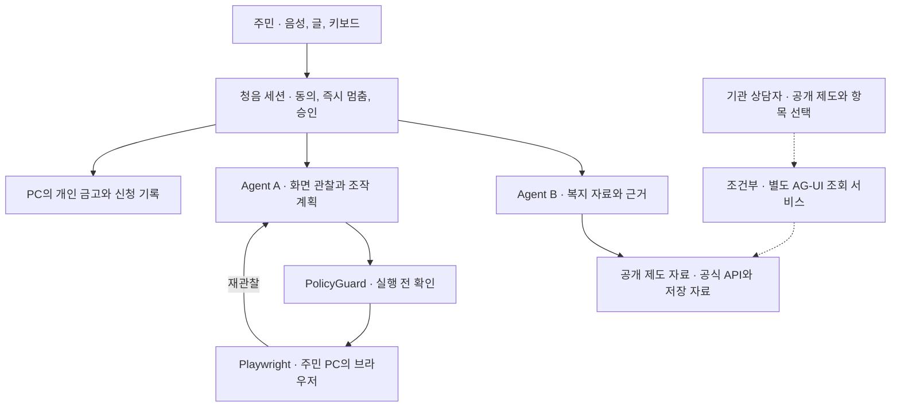

# 청음의 OpenBot 도입 판단과 실행 계획

**11월 21일 갱신.** 현재 TypeScript 앱의 구현 순서와 인수 기준은 [OpenBot v1.1.2 도입 실행 계획](implementation-plan.md)에 있다. [장시간 작업의 중단 원인과 백엔드 개선 계획](long-running-tasks.md)에는 공개 조사 워커의 첫 수정, OpenBot 도구와 스킬, 미완료 단계의 복구 방법을 정리했다. 아래는 Python 파일럿에서 확인한 문제와 당시의 조사 기록이다.

**주민용 청음에는 OpenBot의 승인·복구 설계를 채택한다.** 첫 변경은 이름 한 칸을 채우려는 사람에게 “이름 입력”이라고 정확히 묻는 것이다. 다음은 화면이 끊겼을 때 이용자가 어디까지 했고 무엇을 다시 확인해야 하는지 알려 주는 일이다. 11월 19일 Chromium에서 이름 입력에 “모의접수 승인”이 표시됐고, 그 화면을 새로고침하자 기존 세션 조회가 404를 반환했다. 기관용 OpenBot 연결은 상담자가 공개 복지 자료를 반복 조회할 수요와 운영 주체가 생길 때 추진한다.

**English brief.** Keep Cheongeum as the resident app. Fix what the app says a person is approving, then let them recover their place after a refresh and take back control during identity checks. A separate, read-only benefits lookup is worth piloting for a caseworker team with an existing OpenBot workspace. The local probe demonstrates that one answer and citation can travel over AG-UI. Resident completion and institutional demand still require field evidence.

2026년 11월 19일 제품 판단. 11월 18일의 조사·기능 대조와 두 구현 계획을 통합했다. 아래 번호는 원안의 작업 1~13을 가리키며, 배포 순서는 이번 판단에 따른다. 제품의 성과 지표는 주민이 **도움 없이 목표에 도달한 과제 수 / 시도한 과제 수**다. 실제 신청에서 인증과 최종 제출을 직접 하는 사람은 주민이다. [청음 기획 요약](../기획요약.md) · [사용자 시험 계획](../user-test/plan.md)

[13개 제안의 우선순위](#13개-제안의-우선순위) · [검증 근거와 출시 기준](#근거와-출시-판단) · [조사 결과 재현](#조사-결과-재현)

## 어떤 도입 방식이 맞는가

| 선택지 | 누구에게 어떤 가치가 있는가 | 제품 판단 |
| --- | --- | --- |
| 청음 안에 필요한 설계를 이식 | 주민은 평소의 음성·글·키보드와 자기 브라우저에서 입력, 거절, 재개를 할 수 있다. 청음 팀이 한국어 안내와 상태 처리를 맡는다. | **채택.** 기존 동의, 멈춤, 실행 검증 경로에서 주민이 실제로 막히는 지점을 개선한다. |
| 기관 OpenBot에 AG-UI 조회 연결 | 이미 워크스페이스를 쓰는 상담자가 대화 안에서 제도 원문과 출처를 찾는다. AG-UI는 에이전트의 답변과 상태를 UI로 전달하는 규약이다. | **조건부 실증.** 기관이 반복 과제 하나, 담당자, 시험 환경을 제공할 때 독립 서비스로 검증한다. |
| 기관에 MCP 조회 도구 제공 | 여러 업무 도구가 같은 제도 ID와 항목으로 정형 조회를 호출할 수 있다. MCP는 이런 도구 호출을 연결하는 규약이다. | **보류.** 실제 호출할 클라이언트가 확인되면 같은 공개 조회 함수를 노출한다. 상담 창 연동만 필요한 단계에는 AG-UI 하나로 과업을 검증할 수 있다. |
| OpenBot 전체를 포크해 주민 앱으로 배포 | 계정·채널·여러 Bot·조직 감사까지 갖춘 업무 공간을 얻는다. 대신 주민의 Chrome과 별개인 Bot 브라우저, 한국어 접근성 UI, 설치와 운영을 팀이 책임져야 한다. | **주민 제품에서 제외.** 출시판은 게이트웨이·컴퓨터·supervisor 이미지, PostgreSQL, Intelligence를 사용한다. Windows 설치판의 WSL 2·컨테이너까지 감수할 주민 과업은 이번 조사에서 발견되지 않았다. [OpenBot 구조](https://github.com/CopilotKit/OpenBot/blob/v1.1.0/docs/architecture.md) · [데스크톱 설치](https://github.com/CopilotKit/OpenBot/blob/v1.1.0/docs/desktop-install.md) |

## 주민 과업과 앱의 책임

“기초연금 신청에 어떤 서류가 필요한가요?”라고 물으면 복지 정보 에이전트가 제도와 출처를 확인한다. “신청 도와줘”로 넘어가면 웹 에이전트가 공식 페이지를 관찰한다. 이름 입력은 주민이 대상을 확인한 뒤 실행하고, 인증 화면에서는 주민에게 브라우저를 넘긴다. 신청 뒤에는 주민이 기록한 기한과 기관 화면에서 확인한 접수 결과를 구별해 안내한다. 이 흐름에서 기관 상담자가 주민 세션을 열어야 하는 단계는 없다. [두 에이전트의 인계 계약](../../src/cheongeum/core/turn.py) · [아키텍처와 실제 구현](../architecture-check.md)



| 청음의 단계 | OpenBot 아이디어를 적용할 위치와 경계 |
| --- | --- |
| ① 듣기 | 서버 받아쓰기와 브라우저 대체 경로를 구분한다. 후자는 선택 언어를 기기 안에서 처리할 수 있을 때 시작한다. 청음의 서버 STT·TTS 공급자는 기능·언어·배포 설정에 따라 이용자에게 알린다. [마이크](../../src/cheongeum/web/static/mic.js) · [음성 공급자](../../src/cheongeum/voice/config.py) |
| ② 이해 | 제도명 수정은 선택 기능으로 제공할 수 있다. 멈춤·승인·거절의 의미는 기존 규칙이 판정한다. 실시간 음성 모델에 승인 질문의 재서술을 맡기면 이용자가 들은 문장과 실행 조건이 어긋날 수 있다. [의도 해석](../../src/cheongeum/understanding/llm_planner.py) |
| ③ 상태 | `SessionOrchestrator`가 동의, 중단 세대, 대기 중인 확인을 소유한다. 복귀 시 현재 단계 한 건을 전달하는 데에는 기존 `Progress.seq`와 진행 중 2초 간격 조회를 쓸 수 있다. [세션](../../src/cheongeum/orchestrator/session.py) · [진행 순번](../../src/cheongeum/core/progress.py) |
| ④ 정보와 실행 | Agent B는 공식 API·저장 자료의 항목을 검색한다. 현재 검색은 제도 문서 안의 한글 2-gram과 항목 힌트를 쓴다. Agent A는 현재 페이지·입력 칸·효과를 확인한다. 기관과 공유할 대상은 공개 자료를 찾아 출처를 붙이는 **코드**다. [자료 제공자](../../src/cheongeum/agents/welfare/data/__init__.py) · [검색](../../src/cheongeum/agents/welfare/rag.py) · [화면 효과 판정](../../src/cheongeum/agents/web/effect.py) |
| ⑤ 검증과 권한 | 브라우저 조작은 `PolicyGuard`를 거치고, 승인된 대상과 화면을 대조한다. 아이디·비밀번호 입력, 본인인증, 실제 제출은 주민이 공식 사이트에서 수행한다. 로그인 버튼으로 이동하거나 누르는 기존 도움은 대상을 알리고 한 번 승인받는 경로를 이용한다. [실행 정책](../../src/cheongeum/safety/guard.py) · [승인 지문](../../src/cheongeum/agents/web/approval.py) · [로그인 인계](../../src/cheongeum/agents/web/skills/browse.py) |
| ⑥ 말하기와 보여 주기 | 하나의 확인된 결과로 짧은 음성 안내와 키보드로 읽을 수 있는 텍스트를 만든다. 듣기 어려운 이용자는 마이크를 끄고, 화면을 보지 않는 이용자는 카드 없이도 다음 행동을 선택할 수 있어야 한다. [웹 UI](../../src/cheongeum/web/static/app.js) · [음성·진행 안내](../../src/cheongeum/web/static/speaker.js) |

## 13개 제안의 우선순위

| 원안 | 결정과 이유 | 담당과 규모 |
| --- | --- | --- |
| 1 · 동작별 승인 | **먼저 출시.** 이름 입력을 모의접수로 안내하는 현상을 재현했다. 같은 동작을 음성, 버튼, Enter로 승인할 때 같은 효과와 목적지를 제시한다. | 웹 UI·서버·한국어 UX, 1~2일 |
| 6 · 로컬 API 요청 제한 | **첫 주민 시험 전.** 세션 생성과 음성 처리 요청의 호스트·출처를 로컬 앱 입구에서 검사한다. 다른 화면 때문에 진행 중인 세션이나 음성 서비스가 영향을 받으면 완주 과제도 실패한다. | 서버·데스크톱, 1일 |
| 7 · 브라우저 받아쓰기 | **첫 주민 시험 전.** 자동 대체 음성 인식에 기기 내 처리 조건을 둔다. 시스템 점검 중 OpenAI STT·TTS를 쓰기로 한 기존 결정과 양립한다. [음성 공급자 결정](../../drafts/future%20implementations/speech%20providers%20-%20stay%20on%20OpenAI%20during%20checking.md) | 음성·웹 UI, 2~3일 |
| 11 · 거절 기록과 정책 비교 | **시험 준비에 포함.** 개발 기본 `any`와 시험 설정 `safe`의 차이를 알아야 실제 배포 설정에서 멈추거나 허용되는 일을 판단할 수 있다. [런타임 설정](../../src/cheongeum/server/runtime.py) · [시험 설정](../../tests/conftest.py) | 실행 정책·QA, 1~2일 |
| 2 · 같은 탭에서 이어 하기 | **승인 계약 다음.** 잠깐의 새로고침 때문에 동의부터 다시 해야 한다. 같은 PC의 살아 있는 세션에서 마지막으로 확인한 단계와 다음 선택을 돌려준다. | 세션·웹 UI, 4~7일 |
| 8 · 로그인·인증·보안문자 인계 | **2와 함께 설계하고 이어서 출시.** 누가 브라우저를 조작 중인지와 언제 기다림이 끝났는지를 복귀 후에도 설명해야 한다. | 웹 에이전트·세션, 3~5일 |
| 3·10 · 쉬운 안내와 결과 카드 | **한 작업으로 통합.** 답 한 문장, 근거, 다음 행동 하나를 먼저 정의하고 필요한 부분만 큰 글씨 카드로 표시한다. 원안 3의 받아쓰기 편집은 고유명사 오류로 실제 과제가 막히는지 본 뒤 별도로 시험한다. | 접근성·복지 데이터·웹 UI. 원안 추정은 안내 2~4일, 카드 3~5일이며 겹치는 작업이 있다. |
| 5 · 합성 시연과 사이트별 안내 | **반복 실패가 확인된 과제 한 건에 적용.** QA가 연습 페이지로 재현하고 검토한 단계만 `SitePlaybook`과 회귀 시험에 넣는다. | 웹 자동화·QA, 첫 과제 2~3일 |
| 9 · 신청 기한 문자 | **수요 확인 후 제한 실험.** 이미 앱 시작 때와 사용 중 한 시간마다 기한을 확인한다. 앱을 열지 않아 놓치는 일이 주원인이라면 앱 실행 중 발송만으로 얻는 이점은 작다. [기한 계산](../../src/cheongeum/personal/commands.py) · [알림 UI](../../src/cheongeum/web/static/app.js) | 개인 기능·운영, 3~4일 및 발송 계약 |
| 4 · 기관용 공개 조회 | **기관 수요가 확인될 때 독립 실증.** SDK 통신은 확인했다. 상담자의 조회 시간, 운영비, 기록 보존을 실제 기관 환경에서 판단한다. | 백엔드·기관 담당자, 환경 준비 후 3~5일 |
| 12 · 청음의 비밀번호 가림 입력칸 | **주민 제품에서 제외.** 칸을 찾기 쉬워지는 대가로 청음이 비밀번호를 받아 전달하게 된다. 공식 페이지의 첫 입력 칸에 초점을 주고 직접 입력하도록 돕는 방법을 먼저 관찰한다. [직접 입력 결정](../../CLAUDE.md) | 웹 에이전트·접근성, 작업 8에서 관찰 |
| 13 · 신청서 단위의 일괄 승인 | **운영 도입 보류.** 반복 승인 피로는 측정할 문제다. 지금은 한 번의 응답이 어느 칸에 무엇을 입력하는지 이해하는지가 더 중요하다. | 제품·사용자 연구, 연습 과제에서 승인 횟수와 이해도 비교 |

규모는 원안의 익숙한 개발자 1인 기준 추정치다. 기관 계약, 기기 확보, 참가자 모집은 별도다. 승인 문구는 수정이 끝나는 대로 독립 배포한다.

## 주민 기능의 동작과 인수 조건

### 입력 전에 들은 말과 실제 동작이 일치해야 한다

서버 안에는 이미 `assist`, `click`, `file`과 연습 접수를 구분하는 정보가 있다. 화면에 보내는 `PendingConfirmation`에 동작 종류를 명시하고 목적·대상·결과로 버튼 이름과 음성 문장을 만든다. 예를 들어 “복지로의 이름 칸에 김하늘을 입력할까요?”에 동의하면 그 칸의 값을 다시 읽어 준다. 접수번호는 연습 접수에서 번호를 관찰했을 때만 읽는다. 구버전 응답은 목적과 “이 동작 승인”을 표시한다. 보호자 연락과 금고 저장은 각자의 미리보기와 확인 절차를 사용한다. [응답 계약](../../src/cheongeum/core/turn.py) · [입력 승인](../../src/cheongeum/agents/web/skills/form.py) · [OpenBot 승인 결과](https://github.com/CopilotKit/OpenBot/blob/v1.1.0/shared/approval-outcomes.ts)

**통과 기준**은 이름 입력·로그인 이동·파일 전송·연습 접수에서 화면과 음성이 같은 대상과 효과를 설명하는 것이다. 거절하면 변경 0건, 이름 입력에 동의하면 대상 칸 하나만 바뀐다. 이용자가 직접 처리했다고 말한 상태, 실행 후 관찰로 확인한 상태, 결과를 확인할 수 없는 상태에는 각각 다른 문장을 쓴다. [브라우저 UI 시험](../../tests/e2e/test_web_ui.py) · [신청·멈춤 시험](../../tests/e2e/test_safety.py)

### 로컬 요청과 음성의 처리 위치를 확인한다

- **로컬 API.** FastAPI와 데스크톱이 실제로 쓰는 호스트·포트(기본 웹 8787, 데스크톱 8790)를 허용하고, 브라우저의 상태 변경 요청은 신뢰한 출처와 대조한다. JSON·음성 본문은 각 경로의 형식을 검사한다. 본문 없는 세션 생성·종료와 기존 로컬 도구의 호환성도 확인한다. 허용하지 않은 요청에서 세션 생성·퇴출·공급자 호출은 0건이어야 한다. 헤더 검사는 브라우저의 출처를 다룬다. 로컬 프로그램의 신원 보증이나 기관 로그인에는 별도 인증이 필요하다. [서버 API](../../src/cheongeum/server/app.py) · [웹 클라이언트](../../src/cheongeum/web/static/api.js) · [데스크톱 셸](../../apps/desktop/main.cjs)
- **브라우저 받아쓰기.** 현재는 서버 STT가 없으면 브라우저 API 존재 여부만 확인한다. 제안은 언어별 `available` 확인 후 `processLocally`를 켜고, 언어 팩이 필요하면 사용자의 선택으로 설치하는 것이다. 처리를 확인할 수 없으면 인식을 시작한 횟수는 0이어야 한다. 화면과 음성으로 이유, 키보드 입력, 설정 가능한 서버 받아쓰기 경로를 안내한다. 화면 없이 쓰는 사람을 위해 실제 Electron에서 언어 전환과 음성 대안까지 시험한다. [브라우저 대체 경로](../../src/cheongeum/web/static/mic.js) · [OpenBot의 기기 내 인식 판정](https://github.com/CopilotKit/OpenBot/blob/927b8db60973f5a32ff625fb524a42bf86006fd1/shared/on-device-speech.ts)
- **정책 점검.** `WebExecutionAgent`는 거절하면 로컬 조작 기록의 `before` 행 앞에서 돌아온다. 값 없는 `refused` 결과에 원인 코드·동작 종류·시작 주체(주민·목표 수행·알림)를 남긴다. 35개 기존 시나리오를 `safe`와 `any`로 비교해 허용·거절이 달라지는 지점을 검토한다. 주민 시험에는 `safe`를 쓰고, 배포 기본값은 차이를 검토한 뒤 정한다. [실행 경로](../../src/cheongeum/agents/web/agent.py) · [조작 기록](../../src/cheongeum/personal/action_log.py) · [시나리오 평가](../../scripts/run_scenarios.py)

### 새로고침 뒤에는 마지막으로 확인한 단계에서 시작한다

복구 범위는 **같은 PC·같은 탭에서 서버와 작업 브라우저가 살아 있는 동안**으로 제한한다. 청음이 기억한 안내와 외부 사이트에 실제로 남은 입력은 따로 확인한다. `pagehide` 때의 화면 분리와 명시적 “이용 종료”를 나눈다. 분리 유예 5분은 시험할 제안값이고, 기존 승인 유효시간은 120초다. 두 시간이 겹치면 먼저 끝난 권한을 따른다. [세션 API](../../src/cheongeum/server/app.py) · [요청 종료 처리](../../src/cheongeum/web/static/api.js) · [승인 수명과 멈춤](../../src/cheongeum/orchestrator/session.py)

| 상황 | 복구와 인계의 계약 |
| --- | --- |
| 같은 탭이 다시 연결됨 | 탭에는 교체형 복구 토큰과 마지막 진행 순번만 둔다. 서버가 소유권을 확인하고 “이전 작업을 이어 할까요?”라고 묻는다. 수락 뒤 언어·동의·현재 단계·필요한 확인 종류를 복구한다. 같은 순번은 다시 읽지 않고 놓친 단계는 현재 할 일 하나로 알린다. 지연이 실제 문제로 측정될 때 서버 전송 이벤트(SSE)를 검토한다. 마이크는 주민이 다시 켠다. |
| 승인 응답 유실·중복 클릭 | 승인 대상의 `actionId`, 한 번의 사용자 조작을 식별하는 요청 키, 표시 순번 `seq`는 용도가 다르다. 세션의 직렬 실행 구간에서 요청 키를 선점한다. 같은 키·같은 내용은 진행 중인 실행을 기다리거나 기존 결과를 돌려주고, 같은 키·다른 내용은 충돌로 처리한다. 실행 여부가 불명확하면 화면을 다시 관찰하고 확인을 요청한다. |
| 승인 대기 중 복귀·대상 변경·멈춤 | 복귀 시 현재 화면으로 대상을 재검증하고 새 확인을 받는다. 지난 버튼·늦은 “네”는 효력이 없다. “멈춰”는 대기열보다 먼저 처리해 미실행 동작을 취소한다. 종료·만료 시 토큰을 폐기하고, 복제 탭이 동시에 돌아와도 쓰기 권한은 하나만 부여한다. |
| 로그인·본인인증·보안문자 | 세션에 인계 ID·예상 화면·브라우저·상태·만료를 묶는다. `waiting` 동안 자동 쓰기는 대기열에 넣지 않고, 주민이 직접 처리한다. “다 했어” 뒤 같은 브라우저의 예상 다음 화면을 다시 관찰해야 `completed`로 바꾼다. 기존의 로그인 버튼 도움은 주민이 직접 입력을 마치고 그 버튼을 새로 승인한 경우에만 제공한다. |
| 풀 수 있는 보안문자·실제 접속 차단 | 전자는 사람이 직접 풀거나 사이트의 접근 가능한 대체 절차를 고를 수 있게 안내한다. 인증 화면 촬영·모델 판독은 제외한다. 후자는 사이트별 문의처나 다른 공식 경로를 안내한다. 취소·만료·브라우저 소실은 각각 `cancelled`·`expired`·`interrupted`로 끝낸다. 인계 10분은 제안값이다. |
| 서버 재시작·공용 PC의 다음 이용자 | 새 세션에서 동의부터 시작한다. 주민 구분이 어려운 공용 환경은 복구를 기본으로 끈다. 토큰만으로 같은 사람임을 증명할 수 없다. 이용 종료 후에는 이전 안내·복구 정보·알림 문장이 노출되는지 검사한다. 개인 금고와 Chrome 로그인은 OS 프로필 단위라는 점도 공용 기기 시험에 포함한다. |

현재도 로그인·본인인증 화면을 직접 조작한 뒤 “다 했어”라고 하면 청음이 다시 관찰한다. `DialogueState`의 재개 정보에는 인계의 만료·종료 사유가 없고, 보안문자는 현재 접속 차단으로 분류된다. 위 표는 이 기존 인계를 확장하는 사양이다. [인증 화면 판별](../../src/cheongeum/agents/web/auth_page.py) · [대화 상태](../../src/cheongeum/core/dialogue.py) · [화면 분류](../../src/cheongeum/agents/web/digest.py)

현재 `/state`에는 기록·관찰·확인 값이 담기므로 복구 화면에 통째로 보내면 개인 값까지 나타난다. 현재 기한 안내도 `localStorage`에 알림 문장을 저장한다. 공용 모드 시험에는 다음 사람이 그 문장을 읽을 수 있는 경우를 포함한다. 세션 상한 3개에 도달하면 복구할 자리를 만들기 위해 다른 이용자의 진행 중 브라우저를 닫아서는 안 된다. [현재 스냅숏](../../src/cheongeum/orchestrator/session.py) · [세션 상한](../../src/cheongeum/server/app.py) · [현재 알림 저장](../../src/cheongeum/web/static/app.js) · [OpenBot 인계 상태](https://github.com/CopilotKit/OpenBot/blob/927b8db60973f5a32ff625fb524a42bf86006fd1/shared/computer-control.ts)

**통과 기준**은 같은 승인 두 번, 응답 유실, 120초 경과, 두 탭 복귀, 대상 변경, 멈춤, 재시작을 연습 폼에서 만드는 것이다. 요청 수와 실제 칸 변경·모의접수 건수를 따로 센다. 중복 실행, 인계 중 자동 쓰기, 오래된 승인 실행, 멈춤 뒤 새 실행, 다음 이용자에게 앞사람의 정보가 보이는 경우가 각각 0건이어야 한다. 복구를 끄면 분리된 세션을 정리하고 새 세션으로 시작한다. [기존 승인 시험](../../tests/unit/test_approval.py) · [브라우저 이력 시험](../../tests/e2e/test_history_safety.py)

### 근거 있는 답 하나를 듣거나 읽을 수 있게 한다

`TurnResult`의 선택적 카드로 복지 답·서류 목록·승인·인계를 표시한다. 한 화면에는 **답 한 문장, 근거 기관과 자료 기준, 다음 행동 하나**를 먼저 보여 준다. 버튼도 같은 음성·텍스트 명령 경로를 사용한다. 확인된 필드·서류·관찰에서 완료 표시를 만들면 한국어 “완료”를 영문 키워드로 추정할 필요가 없다. 키보드 포커스를 유지하고 상태 안내를 앱 음성과 화면낭독기가 중복해서 읽는지 실제 기기에서 확인한다. [현재 응답 형식](../../src/cheongeum/core/turn.py) · [W3C 상태 메시지](https://www.w3.org/WAI/WCAG22/Understanding/status-messages.html)

복지 답은 해당 제도 ID, 실제 인용 항목, `grounded`, 개별 응답의 `dataOrigin`을 확인한다. 공식 API 장애로 저장 자료가 나온 경우, 지자체 자료, 공공데이터에 실린 민간 사업을 구분한다. 자료 버전·기준연도와 마지막 확인일(`lastCheckedAt`)은 따로 표시한다. 링크가 붙은 `general-llm` 답도 `grounded=False`일 수 있다. 현행 숫자 검사는 질문과 상위 검색 조각 전체를 보므로 주민이 잘못 기억한 금액도 일치할 수 있다. 카드의 금액·기한·자격 안내는 **인용한 항목**의 제도·조건·수치·단위·연도가 맞을 때 제시하고, 빠진 근거는 “확인 필요”와 공식 문의 경로로 표시한다. 자격은 사전 확인으로 안내하고 최종 수급 판정은 담당 기관에 맡긴다. [복지 답변과 대체 경로](../../src/cheongeum/agents/welfare/agent.py) · [숫자 검증](../../src/cheongeum/safety/verify.py) · [공개 자료 시험](../../tests/e2e/test_public_datasets.py)

**통과 기준**은 마이크를 끄고 키보드만 쓴 사람과 화면을 보지 않고 들은 사람이 각각 서류와 다음 행동을 찾는 것이다. 한국어·영어·중국어·일본어에서 제도·기관의 원명과 숫자·날짜·전화번호를 대조한다. 잘못 알아들은 제도명 때문에 되풀이가 많으면 “고쳐서 보내기”를 시험한다. 초안은 세션 동의 후 화면 메모리에만 두고 전송·취소 때 지운다. 인증 중에는 초안을 만들지 않고 멈춤은 편집을 거치지 않는다. [다국어 시험](../../tests/e2e/test_multilingual.py) · [받아쓰기 API](../../src/cheongeum/server/app.py)

## 조건부 과제의 시작과 종료 기준

**기관 상담자의 공개 복지 조회(4).** 상담자가 송신 전에 공개 제도 ID와 항목(대상·서류·신청 방법·문의)을 선택한다. 자유문을 OpenBot 대화에 먼저 쓰면 어댑터에서 가려도 워크스페이스는 이미 원문을 받는다. 실증은 합성 질의로 시작한다. 인증된 독립 프로세스에서 요청마다 새 `WelfareInformationAgent`를 만들고 선택한 항목을 `answer_policy_question`의 규칙 답변에 연결한다. 요청한 제도와 반환 제도·근거가 일치해야 한다. 답문과 출처 상태 양쪽에 자료 구분·기준일을 담아 카드가 없는 화면에서도 읽을 수 있게 한다. [정형 복지 답변](../../src/cheongeum/agents/welfare/agent.py) · [AG-UI 프로브](probe/check.py) · [OpenBot 원격 에이전트 예제](https://github.com/CopilotKit/OpenBot/tree/v1.1.0/examples/pydantic-ai-bot)

기관 서비스에는 공개 자료 제공자만 연결한다. 허용된 제도·항목을 검사하고 출처는 검토한 공식 호스트의 공개 URL로 제한한다. 주민의 `/api/turn`·`/state`, Chrome 프로필, 금고, 음성·파일·사진·문자 도구에는 접근 권한을 두지 않는다. 청음의 화면 분석은 기능별 전송 고지와 제한을 따르고, 다운로드 문서 분석은 파일별로 확인받는다. 이런 주민용 응답에는 입력값이 섞일 수 있다. OpenBot이 제공하는 도구와 외부 에이전트가 자체 보유한 도구는 실행 권한을 관리하는 주체도 다르다. [로컬 런타임](../../src/cheongeum/server/runtime.py) · [파일 전송](../../src/cheongeum/agents/web/file_answer.py) · [화면 촬영 정책](../../src/cheongeum/agents/web/shot.py) · [OpenBot 도구 승인](https://github.com/CopilotKit/OpenBot/blob/v1.1.0/docs/approvals.md)

기관 담당자가 실제 워크스페이스에서 등록·인증·재연결·등록 해제·기록 삭제와 비용을 확인한다. 두 대화 간 답 혼입, 외부 조작 호출, 근거 없는 공식 답변이 각각 0건이어야 한다. API 장애와 지연 때 저장 자료나 확인 불가 상태가 보이는지도 시험한다. 기존 조회 방식과 비교해 상담자가 **정확한 출처에 도달하는 시간과 성공 건수**가 개선될 때 운영 투자를 검토한다. 모델 재서술은 중앙·지자체·민간 자료에서 유사 제도명, 틀린 금액·연도, 누락 항목, 오타·번역을 규칙 답변과 비교한 뒤 도입한다. 검증에 실패하면 원자료의 해당 항목을 사용한다.

**사이트 시연(5).** 같은 사이트 과제가 반복해서 실패하면 담당자가 접근 가능한 이름, 예상 화면 변화, 주민이 직접 할 대안을 합성 연습 페이지에 재현한다. 검토한 시나리오를 회귀 시험으로 남기고 화면 구조가 달라지면 추가 클릭을 멈춘다. OpenBot Recorder는 시연 중의 페이지와 입력·네트워크 내용까지 다룰 수 있다. QA의 합성 시연에만 사용하고 이름이 페이지 본문·속성·파일명에 다시 나타나는 사례도 마스킹 시험에 넣는다. [사이트별 안내](../../src/cheongeum/agents/web/playbook.py) · [느린 페이지 회귀 시험](../../tests/e2e/test_slow_pages.py) · [Recorder 수집 고지](https://github.com/CopilotKit/OpenBot/blob/v1.1.0/shared/recorder-disclosure.ts)

**기한 문자(9).** 주민이 기한을 놓친 이유와 원하는 수신자를 먼저 확인한다. 실험은 기존 Solapi 발송 인터페이스와 모의 미리보기를 재사용한다. 보호자 도움 요청에 대한 동의와 기한 알림 동의를 분리해 신청별로 번호·수신자·문구를 확인한다. 기본 문구에는 제도명을 생략한다. 제안값은 3일 전·1일 전, 신청당 하루 1통·전체 하루 3통, 연속 실패 10회 시 중지다. 수신 취소·신청 완료 뒤 발송과 재시도에 따른 중복 발송은 0건이어야 한다. 앱 안에서 해지 방법을 제공하고 문자에도 알린다. [보호자 문자](../../src/cheongeum/personal/guardian.py) · [기존 문자 시험](../../tests/e2e/test_guardian_contact.py)

첫 실험의 전달 범위는 **청음이 켜져 있을 때**로 명시한다. 앱을 닫은 날에 보내야 효과가 있다면 PC가 켜져 있어야 하는 로컬 예약 실행과 기관 서버가 번호·기한을 보유하는 방식의 추가 비용을 비교한다. 전달할 방법이 확인될 때까지 앱을 닫아도 알림을 받는다고 약속할 수 없다.

**반복 승인(13).** 현장에서는 한 과제를 끝내는 데 필요한 승인 횟수와 주민이 각 동작을 이해했는지 함께 기록한다. 반복이 주된 이탈 원인으로 관찰되고 한 번 승인 원칙을 바꾸기로 명시적으로 결정할 때만 연습 폼에서 범위 승인을 비교한다. 그 실험은 같은 세션·출처·경로·신청서의 일반 입력 칸에 한정한다. 화면 변경·멈춤·만료로 끝내며 제안 상한은 10분이다. 제출·로그인·파일 전송·비밀값·항상 허용은 범위 밖이다. [청음의 실행 원칙](../../CLAUDE.md) · [OpenBot 승인 범위](https://github.com/CopilotKit/OpenBot/blob/927b8db60973f5a32ff625fb524a42bf86006fd1/docs/approvals.md)

주민 앱에는 실시간 모델 통화, 주민 화면 녹화·Automatic Learning, 장기 대화 메모리, 팀 앱 연결·일정 실행을 도입할 근거가 없다. 이 기능들은 주민의 말과 화면을 다루는 주체, 보존 기간, 실행 권한을 늘린다. 기존 Python 정책에 CEL을 더하거나 범용 도구 검색·Bot 간 메시징·모델 호환성 관리 계층을 추가하는 비용도 현재 두 에이전트의 과업으로 정당화하기 어렵다. 워크스페이스 운영 자체가 기관의 목표가 되면 계정·감사·백업·서버 비용과 Intelligence·검색·텔레메트리의 보존·삭제 조건까지 포함해 전체 도입을 재검토한다. 원본 코드를 옮기는 경우에는 고정한 버전·경로·수정 이력과 MIT 고지를 남긴다. 템플릿의 MIT와 Intelligence의 이용 조건은 별개다. [개인판 정책](https://github.com/CopilotKit/OpenBot/blob/v1.1.0/docs/personal-edition.md) · [템플릿 라이선스](https://github.com/CopilotKit/OpenBot/blob/v1.1.0/LICENSE) · [Intelligence 운영 조건](https://github.com/CopilotKit/OpenBot/blob/v1.1.0/README.md#open-source-local-operation-and-licensing)

## 근거와 출시 판단

11월 18일 조사의 실험 기준은 OpenBot `v1.1.0`(`e373655`), 기능 조사 기준은 당시 `main`(`927b8db`)이다. 청음은 `feat/local-stt-privacy`의 `9842310` 위 미커밋 변경을 포함한 작업 트리 기준이다. 아래에서 날짜는 관찰 또는 실행한 날을 뜻한다. [실험 릴리스](https://github.com/CopilotKit/OpenBot/releases/tag/v1.1.0) · [기능 조사 스냅숏](https://github.com/CopilotKit/OpenBot/tree/927b8db60973f5a32ff625fb524a42bf86006fd1)

| 근거 | 결과 | 판단에 쓸 수 있는 범위 |
| --- | --- | --- |
| 청음 UI·FastAPI·Chromium, 11월 19일 재현 | 합성 이름 입력 요청에서 `WAITING_FOR_USER_CONFIRMATION`, 실행 0건이었다. 서버 목적은 “실제 사이트 입력란 채우기(제출은 하지 않음)”인데 화면에 “모의접수 승인”과 접수 힌트가 나타났다. | 승인 문구의 불일치는 현재 작업 트리에서도 발생한다. 주민이 이를 얼마나 자주 오해하는지는 사용성 시험에서 측정한다. |
| 같은 승인 화면에서 새로고침, 11월 19일 재현 | 기존 세션 조회는 HTTP 404, 새 세션은 다른 ID와 `AWAITING_CONSENT`를 반환했다. | 사용자가 잃는 것은 청음 안내 세션이다. 외부 사이트가 신청 내용을 저장했는지는 별도 확인이 필요하다. |
| 실제 Python·JS AG-UI SDK 루프백, 11월 19일 재실행 | 저장 장애인연금 사례 한 건에서 이벤트 6개, 한국어 답변 1개, 출처 1개, 도구 호출 0건. 범위 밖 신청서 열기는 422였다. | SDK 간 호환이 확인됐다. 전체 OpenBot 등록·인증·Intelligence 재연결·운영 비용은 기관 실증 대상이다. [JS 클라이언트의 검증 항목](probe/client.cjs) |
| 장애인연금 저장 원문에 대한 한국어 20문항, 11월 19일 재실행 | 정답 항목이 상위 3개에 든 질문 20/20, 첫 정답 순위 역수의 평균(MRR) 0.95. | 한 제도 안에서의 항목 검색 지표다. 답문·자격 판단·번역과 다른 제도의 정확도는 별도 평가한다. [질문 자료](../../src/cheongeum/evaluation/data/rag_qa.json) |
| 회귀 시험 | 11월 19일 승인·인증 화면·검색 관련 선별 시험 13개 통과. 11월 18일 원 조사에서는 청음 12개 파일 241개, OpenBot 4개 파일 99개 통과. 당시 상류 체크리스트는 영문 “Done”만 완료로 세고 한글 “완료”는 열린 항목으로 남겼다. | 자동 시험은 정책·계약을 확인한다. 실사용자 완주율, 실제 인증, 저사양 기기 성능은 아직 현장 측정값이 없다. |

**주민 시험의 출시 질문은 “무슨 일이 일어날지 알고 혼자 다음 단계로 갔는가?”다.** 저장소에 기록된 실사용자 시험 참여자는 0명이다. 첫 시험은 과제와 비교 조건이 정해진 상세 계획에 따라 시각장애인 3~5명을 모집하는 안을 쓴다. 평소 화면낭독기 조건과 비교하고, 현재판과 후보판에는 난도가 비슷한 합성 조회·입력 과제를 번갈아 배정한다. 입력 효과를 설명하기, 거절하기, 중간에 멈추기, 같은 탭으로 돌아오기, 직접 인증 후 결과 확인하기를 관찰한다. 실제 신청·인증 정보는 과제에 넣지 않는다. [사용자 시험 계획](../user-test/plan.md) · [과제 카드](../user-test/tasks.md)

- **완주와 이해.** 조건별 시도 수, 무도움 완주 수, 도움 횟수, 첫 안내·완료까지 걸린 시간, 잘못 이해한 동작을 센다. 입력을 접수로 이해한 사람이 있으면 해당 문구를 고쳐 재시험한다. 작은 표본에서는 각 중단 이유를 함께 보고한다.
- **다른 이용 조건.** 첫 결과를 전체 정보취약계층에 일반화하지 않는다. 다음 시험에서 절차가 낯선 고령 이용자, 글·키보드 선호 이용자, 한국어를 추가 언어로 쓰는 이용자, 공용·저사양 PC 및 불안정한 연결을 쓰는 이용자의 과제를 확인한다. 입력·언어 조건별로 완주가 어려워지면 해당 기능의 확대를 보류한다.
- **기록.** 과제 ID·입력 방식·단계·결과 코드·시간만 집계한다. 중복 실행·멈춤 뒤 실행·다음 이용자 노출은 0건이 출시 조건이다. 속도와 승인 횟수의 개선은 이 조건과 주민의 이해도를 충족한 뒤 판단한다. [비식별 이벤트](../../src/cheongeum/core/events.py) · [현장 기록지](../user-test/record-sheet.csv)

## 조사 결과 재현

아래 명령은 청음 개발 환경이 준비된 Windows에서 저장소 루트를 기준으로 실행한다. 운영 계정이나 주민 정보 없이 합성 자료를 사용한다.

<details>
<summary>승인·새로고침과 청음 회귀 시험</summary>

`PRACTICE_MODE=true`, `REQUIRE_CONSENT=true`, `READ_ONLY_CLICKS=safe`, 모의 LLM·음성 공급자와 복지 fixture로 연습 사이트와 청음 UI를 실행한다. `127.0.0.1:5174`는 기본 연습 사이트 `localhost:5174`와 출처가 달라 외부 포털 역할을 한다. 위의 Chromium 재현은 웹 UI 시험과 같은 로컬 런타임을 사용했다. [웹 UI 시험 환경](../../tests/e2e/test_web_ui.py)

1. UI에서 동의하고 `127.0.0.1:5174/external.html 열어줘`, `이름 칸에 김하늘 써줘`를 차례로 입력한다. 서버의 실행 건수·목적과 화면 버튼·힌트를 대조한다.
2. 승인 전에 청음 UI를 새로고침한다. 새 세션의 ID·상태와 이전 세션의 상태 조회 결과를 대조한다.
3. 11월 19일 선별 시험은 아래 명령으로 실행한다. 검색 시험의 입력은 `tests/fixtures/welfare-detail-WLF00003249.xml`과 위 20문항이다.

```powershell
& '.venv/Scripts/python.exe' -m pytest -q tests/unit/test_approval.py tests/unit/test_auth_page.py tests/unit/test_welfare.py::test_retrieval_quality
```

11월 18일의 청음 회귀 묶음은 다음과 같다. 다른 작업 트리에서는 통과 건수가 달라질 수 있다.

```powershell
$checks = @(
    'tests/unit/test_welfare.py', 'tests/unit/test_policy.py', 'tests/unit/test_llm_privacy.py',
    'tests/unit/test_approval.py', 'tests/unit/test_progress.py', 'tests/unit/test_i18n_voice_llm.py',
    'tests/e2e/test_safety.py', 'tests/e2e/test_history_safety.py', 'tests/e2e/test_guardian_contact.py',
    'tests/e2e/test_public_datasets.py', 'tests/e2e/test_web_ui.py', 'tests/e2e/test_autopilot.py'
)
& '.venv/Scripts/python.exe' -m pytest -q @checks
```

</details>

<details>
<summary>기관 계정 없이 AG-UI 통신 확인</summary>

Python `ag-ui-protocol==1.0.0`과 릴리스에 맞춘 JS `@ag-ui/client@1.0.2`를 사용한다. JS 의존성은 임시 폴더에, Python SDK는 `uv`의 별도 실행 환경에 설치한다. [Python 서버·실행기](probe/check.py) · [JS 검증 코드](probe/client.cjs)

```powershell
$probeDir = Join-Path ([IO.Path]::GetTempPath()) ('cheongeum-agui-' + [guid]::NewGuid().ToString('N'))
npm.cmd install --prefix $probeDir --ignore-scripts --no-package-lock --no-audit --no-fund '@ag-ui/client@1.0.2'
if ($LASTEXITCODE -ne 0) { throw 'AG-UI client installation failed' }
$previousNodePath = $env:NODE_PATH
try {
    $env:NODE_PATH = Join-Path $probeDir 'node_modules'
    uv run --no-sync --with 'ag-ui-protocol==1.0.0' python -X utf8 docs/openbot/probe/check.py
} finally {
    $env:NODE_PATH = $previousNodePath
}
```

기대 순서는 `RUN_STARTED → TEXT_MESSAGE_START → TEXT_MESSAGE_CONTENT → TEXT_MESSAGE_END → STATE_SNAPSHOT → RUN_FINISHED`다. `messages=1`, 출처의 `dataOrigin=fixture`, `outOfScopeStatus=422`를 확인한다.

</details>

<details>
<summary>OpenBot 릴리스에서 비교한 네 가지 계약 시험</summary>

별도 작업 폴더에서 실행한다. 11월 18일 기록은 Bun 1.4.3과 아래 릴리스 기준이다. 기관 배포를 검토할 때도 코드와 이미지 버전을 함께 고정해 비교한다. [릴리스 이미지 목록](https://github.com/CopilotKit/OpenBot/blob/v1.1.0/backend-images.env)

```powershell
git clone --depth 1 --branch v1.1.0 https://github.com/CopilotKit/OpenBot.git OpenBot-v1.1.0
$upstreamChecks = @(
    './OpenBot-v1.1.0/shared/approval-outcomes.test.ts',
    './OpenBot-v1.1.0/shared/recorder-disclosure.test.ts',
    './OpenBot-v1.1.0/shared/recorder-masking.test.ts',
    './OpenBot-v1.1.0/shared/routine-checklist.test.ts'
)
npm.cmd exec --yes --package=bun@1.4.3 -- bun test @upstreamChecks
```

</details>
