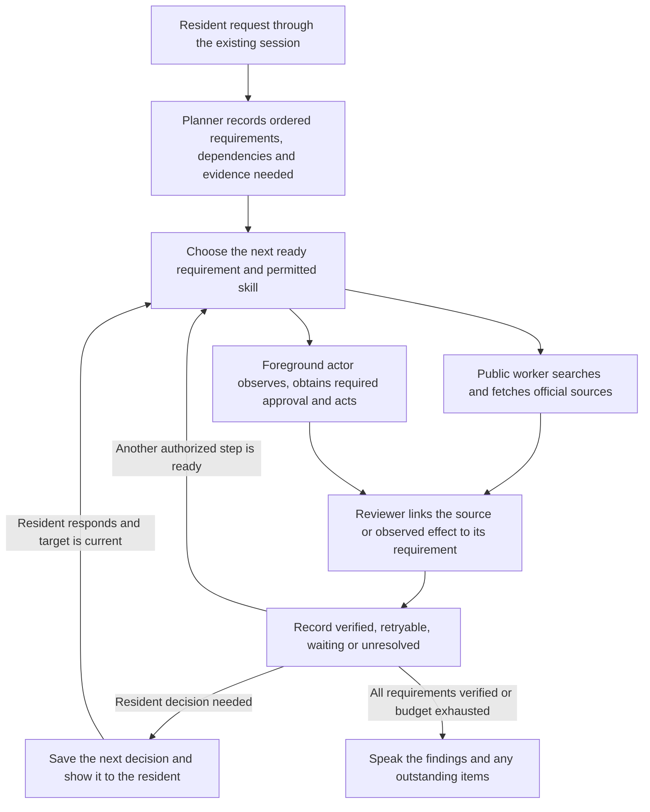

# Long-running tasks in Cheongeum

**A task should keep going while it has an authorized next step, preserve what it has verified, and tell the resident exactly what requires their attention.** For example, a resident asks for the required documents and deadlines for two programs. After both document lists are verified, a slow agency page or an app restart should leave only the missing deadlines to research. If the resident also asks to open a personal application, the app can present that decision when they return.

## Implementation

- A reviewed public job saves its ordered requirements and quote-to-source findings in the existing SQLite or PostgreSQL queue. A replacement worker reads the last committed revision and skips verified items. The worker can yield twice to other ready jobs, within fifteen minutes of active work. Each requirement can use up to two reserved attempts. Each attempt has up to two review rounds and eight browser decisions. A checkpointed question can receive a public reply under the same job ID. [Checkpoint contract](../../src/core/research.ts) · [Workflow store](../../src/server/workflow_store.ts) · [Worker](../../src/server/workflows.ts)
- Foreground review keeps unfinished actions and their dependencies. An independent public lookup can continue after a browser failure. A dependent browser action waits when the earlier effect is uncertain. An authentication handoff on the original live browser gets fresh Done and Cancel choices after reconnect. [Review loop](../../src/orchestrator/review_loop.ts) · [Session recovery](../../src/orchestrator/session.ts)
- The first two public research skills use the existing search path. When official snippets are insufficient, Tavily Extract retrieves the selected notice and the verifier checks the cited text. The research panel displays source dates and open items. A resident can also say “맡긴 조사 결과 읽어줘” to hear the latest saved result. [Skills](../../src/orchestrator/public_skills.ts) · [Search and fetch](../../src/server/public_search.ts) · [Tavily Extract](https://docs.tavily.com/documentation/api-reference/endpoint/extract)

Additional provider benchmarking, parallel task branches and automatic completion notices with per-revision acknowledgement remain rollout work. The serial lookup and continuation paths are available for fixture testing.

The restart test reopens the SQLite queue with two workers after a lease expires. One worker is eligible to resume, and the earlier lease cannot save or publish. A separate test simulates a five-minute window and confirms that a second queued job finishes before the first resumes. Hono and Chromium tests cover reading a partial result, replying to the current question under the same job ID, retaining a dependent foreground action after a failure, and choosing a refreshed authentication handoff after reconnect. Live-provider quality and PostgreSQL operation require their own runs.

## Where the current backend loses progress

| Path | Observed behavior | Change |
| --- | --- | --- |
| Delegated public lookup | A 120-second database lease also set a 105-second execution cutoff. A synthetic provider returned after the job had already been requeued. The queue started the same question again. | **Implemented here.** The holder renews every 60 seconds. A 130-second simulated lookup now completes once. A stalled lookup or browser startup reaches a separate five-minute budget and releases the worker for the next job. Cancellation or lease loss prevents late publication. Five minutes is an initial choice to revisit against real lookup durations. [Worker](../../src/server/workflows.ts) · [Store](../../src/server/workflow_store.ts) · [Regression tests](../../tests/unit/server-workflows.test.ts) |
| Foreground multi-action task | A three-action probe of the real `ReviewLoop.actions` with a stubbed browser route ran `READ_MAIN` and `CURRENT_STEP`. When the second returned `none`, `ABOUT_SITE` never ran and the remaining queue was empty. The reviewer still had the request but would need to reconstruct the third step. | Keep the original order and the outcome of each requirement. Replan only its unfinished portion. Reuse the live browser journey’s visited routes, dead ends and current stage. [Review loop](../../src/orchestrator/review_loop.ts) · [Browser journey](../../src/agents/web/journey.ts) |
| Verification over long runs | Reviewed tasks have 2, 3 or 5 review rounds and 8, 16 or 32 browser decisions/actions by difficulty. The reviewer takes the last 128 evidence records. With enough later observations an early receipt can drop out of the review input. | Retain each requirement’s proof references as long as the task needs them. Budget browser actions, verification and retries separately. Trace which limit actually ended a run. [Review limits](../../src/orchestrator/review_loop.ts) · [Evidence selection](../../src/orchestrator/task_review.ts) |
| Process restart | The queue retains the original public prompt, attempts, lease and terminal result. The worker starts a fresh background session. In-flight step results and the next step are absent from the stored job. | Add a versioned checkpoint for approved public research. Re-observe a foreground browser and renew the required authorization before continuing personal work. [Queue schema](../../src/server/workflow_store.ts) · [Public planner](../../src/orchestrator/public_plan.ts) · [Session recovery](../../src/server/app.ts) |

The first change passed TypeScript checking, the unit suite (2,018 passed) and four selected end-to-end suites (37 passed). Twenty unit cases and one live-model journey were skipped, including the optional PostgreSQL cases. The delay and browser-start regressions use a real SQLite store and a simulated clock. The frequency of each failure in resident sessions still needs measurement.

## OpenBot’s tools and skills, and their Cheongeum equivalents

The comparison uses OpenBot v1.1.2. Its public template exposes tool names, skill instructions, run notices, and the architecture of the gateway and Intelligence service. OpenBot documents a persistent queue and renewable worker leases for Bot handoffs. That is the upstream pattern used in the first fix. The release distributes backend components as images. The requirement-level scheduler below is Cheongeum’s proposed implementation. [Release](https://github.com/CopilotKit/OpenBot/releases/tag/v1.1.2) · [Upstream queue and leases](https://github.com/CopilotKit/OpenBot/blob/v1.1.2/docs/architecture.md#one-bot-handing-work-to-another)

| What OpenBot actually uses | How to apply it here |
| --- | --- |
| Its `research-public-web` skill asks for `@research/search` and `@research/fetch`. The adapters are Parallel (`web_search`, `web_fetch`), Exa (`web_search_exa`, `web_fetch_exa`) and Firecrawl (`firecrawl_search`, `firecrawl_scrape`). | Give public research the same two capabilities. Start with the official catalog and existing Tavily search. When a search excerpt lacks the requested field, fetch the selected official page and extract a quote, date and URL. Try one upstream adapter, starting with Parallel, against the same Korean HTML/PDF fixture set. Compare field coverage, latency and cost before enabling a provider. [OpenBot adapters](https://github.com/CopilotKit/OpenBot/blob/v1.1.2/shared/research.ts) · [Cheongeum search](../../src/server/public_search.ts) |
| Personal example skills include `find-a-document` (Drive search, file contents and metadata), `find-a-notion-page` (Notion search and fetch), `skill-creator` and `bot-creator`. The fintech examples add `check-a-claim`, `whats-changed` and `who-owns-this`. Skill authoring uses `list_skills`, `read_skill`, `list_skill_tools` and a reviewed `save_skill`. | Adopt `check-a-claim` as a welfare task that returns a quote and a supported, contradicted or unstated finding. Adapt document finding to official Korean notices and change detection to explicit, recurring public checks. Begin with versioned skills reviewed in Git alongside practice-site fixtures. Office connectors and in-app skill authoring belong to the institutional track when a workflow needs them. [Personal skills](https://github.com/CopilotKit/OpenBot/blob/v1.1.2/examples/personal/skills.yaml) · [Fintech skills](https://github.com/CopilotKit/OpenBot/blob/v1.1.2/examples/fintech/skills.yaml) · [Skill authoring and tool selection](https://github.com/CopilotKit/OpenBot/blob/v1.1.2/docs/architecture.md#which-tools-a-run-is-offered) |
| The browser tools include `computer_navigate`, `computer_read`, `computer_snapshot`, `computer_click`, `computer_type`, `computer_scroll`, `computer_key` and `computer_request_help`. | Map read/navigation to the existing Playwright observation and portal discovery, and click/type to target-bound execution followed by inspection of the resulting page. An authentication page goes to the existing resident handoff. Keep a single owner of the resident’s browser and use the current policy guard for each effect. [OpenBot computer tools](https://github.com/CopilotKit/OpenBot/blob/v1.1.2/app/src/lib/copilot/computer-tools.tsx) · [Cheongeum execution](../../src/agents/web/agent.ts) · [Policy guard](../../src/safety/guard.ts) |
| `message_bot` passes work, constraints and success criteria to another Bot. `ask_person` obtains a human decision. `run_subagent` supports independent work. Optional task threads expose `delegate`, `follow_up` and `stop`. v1.1.2 requires `OPENBOT_TASK_THREADS=on` to use task threads. | First give the existing public worker an explicit list of fields and completion criteria. Address follow-up and Stop to the original task ID. After checkpointing works, trial up to two independent public reads with one parent budget and cancellation signal. Both return evidence to the same verifier. [Coworkers](https://github.com/CopilotKit/OpenBot/blob/v1.1.2/docs/coworkers.md) · [Subagent contract](https://github.com/CopilotKit/OpenBot/blob/v1.1.2/shared/subagent.ts) · [Task thread tools](https://github.com/CopilotKit/OpenBot/blob/v1.1.2/shared/orchestration.ts) · [Release default](https://github.com/CopilotKit/OpenBot/blob/v1.1.2/CHANGELOG.md#112) |
| A routine checklist identifies parts still open. Run notices ask a Bot to act on a promise when it made no tool call. The release describes a bounded retry and a final account of unfinished work. | Drive continuation from typed requirement states and tool receipts across all supported languages. If the model says it will check the deadline and returns no tool call, allow a bounded repair for that open field. Once the budget is spent, return the findings, the missing field and the reason. [Checklist](https://github.com/CopilotKit/OpenBot/blob/v1.1.2/shared/routine-checklist.ts) · [Run notices](https://github.com/CopilotKit/OpenBot/blob/v1.1.2/shared/run-notices.ts) · [Release history](https://github.com/CopilotKit/OpenBot/blob/v1.1.2/CHANGELOG.md) |

In OpenBot the Bot receives tools allowed for the actor and exposed for this run. Selecting a skill can narrow the tools for the task. The gateway checks access and dispatches tool calls. The computer executes browser actions, and AG-UI events bring results and decisions back to the conversation. Cheongeum can use the same division of responsibility with its existing Hono session, policy guard, worker and reviewer. Replaying conversation events restores what someone sees. Resuming execution also requires a record of what happened in the outside world. [OpenBot runtime flow](https://github.com/CopilotKit/OpenBot/blob/v1.1.2/docs/architecture.md#runtime-flow)

## How a task would run

Extend `ReviewedTask` with stable requirement IDs, dependencies, allowed operations, status, proof references and a reason for each unresolved item. The verifier already validates quotes and distinct action receipts. Make those checks authoritative for completion. Persist progress after each verified public step using a versioned checkpoint and a conditional update on owner, job, live lease and expected revision. Keep the current requirement, remaining IDs, source evidence and cumulative budgets together. A reclaimed worker reads the last committed revision. An older queued job without a checkpoint initializes one from its saved prompt. Read older terminal results through PR 1’s saved-result format. [Reviewed task](../../src/orchestrator/review_loop.ts) · [Verifier](../../src/orchestrator/task_review.ts) · [Store](../../src/server/workflow_store.ts)

**Let a healthy task span multiple worker runs.** Once checkpoints exist, a worker nearing its five-minute limit saves verified progress and yields the same job back to the queue if authorized work and a task-wide budget remain. Schedule it behind other ready jobs. Keep continuation count separate from failed attempts. Carry active time, tool calls and model usage across every continuation. A transient source outage gets a scheduled retry with backoff. A repeated observation without progress gets one bounded alternative, followed by an explicit unresolved result. A task waiting on the resident wakes on their answer. The resident can close the window and return to the same task ID and evidence.

**Recovery depends on what happened.** A failed public read can try another official source within budget. A renamed control calls for fresh observation. An unavailable field can be marked unresolved while an independent authorized read continues. A missing resident decision pauses its dependent steps. After an ambiguous write, inspect the official outcome and request help if it cannot be verified. Store the intent and its observed receipt separately so a crash between them cannot replay an effect. Stop cancels every outstanding branch. A lease renewal establishes worker ownership. Only new evidence or a verified step counts as task progress.

Persist only the approved public fields in the research database. Keep resident cookies, credentials, form values, screenshots and live approval tokens in their existing foreground boundaries. Continuing private work after a restart requires a current page and a newly bound decision where appropriate. The public worker can continue consented research when the service runs again. Running while the desktop service is fully stopped requires a separately operated worker. [Runtime capabilities](../../src/server/runtime.ts) · [Handoff recovery plan](implementation-plan.md#first-release)

## Delivery order and proof

| Order | Backend change | Acceptance test |
| --- | --- | --- |
| 1 · Classify stops | Record a typed reason at worker, planner and reviewer exits. Distinguish user Stop, required input, policy, source unavailable, no progress, exhausted budget, lost lease and verified completion. Count attempts, elapsed time and tool calls without retaining prompts or form values. | The same attempt has one final outcome, with a reason an engineer can reproduce. Establish a before/after baseline using the existing long-task fixtures. |
| 2 · Keep unfinished foreground steps | Replace the destructive queue drain with per-requirement transitions. Keep verified receipts available even after the latest 128 observations. Spend a bounded repair on missing or malformed output. Try another authorized route only when it can produce new evidence. | In a three-part task, a failed middle step preserves the first receipt and the third step. An independent third step runs. A dependent third step waits. A promise without a tool call cannot complete the task. |
| 3 · Resume public work from evidence | Extend PR 1’s saved-source projection and the SQLite/PostgreSQL store with the versioned checkpoint. Charge retries and elapsed active work across attempts. Surface verified and missing fields in PR 3’s spoken inbox. Discard a stale worker’s writes and remove checkpoints on deletion. | Terminate the process after saving one of two official sources. Reopen with two workers. The verified source is retained, only the other lookup runs, and the inbox receives one result. Cancel and resume cases cannot publish stale work. |
| 4 · Ship the first two skills | Add manifests for finding official documents and checking an agency claim. Declare inputs, permitted reads, expected outputs, evidence requirements, owner and version. Pair each with a changed-page fixture and use the same verifier for parallel or serial reads. | For two synthetic programs, the result covers each requested document and deadline or names the missing field. A search snippet that omits the deadline triggers a fetch. A different agency’s date and an unsupported quote fail verification. |
| 5 · Pilot longer and parallel runs | Add automatic continuation across worker runs, with fair queue ordering, a total budget and capacity reserved for final verification. Trial limited parallel public reads after the serial baseline can recover. | A two-program lookup crosses two five-minute windows and a restart, completes from its checkpoints, and lets a second queued job finish between windows. Compare sourced completions, premature stops and cost under the same overall budget. A lost receipt or repeated approval causes zero duplicate effects. |

Run the browser scenarios through Hono and the practice portal, and the restart scenarios against a real workflow store. Add disconnection during approval, interruption after an effect but before its receipt, and 130 seconds of healthy provider latency. Count **premature stops / attempts with an authorized, executable next step**, and report intentional stops, human handoffs, false completions and duplicates separately. Release the continuation changes when the interrupted fixtures recover their verified work, no unsafe replay occurs, and the same-budget comparison reduces premature stops. [Long-task scenarios](../../tests/e2e/qa-long-tasks.test.ts) · [Review-loop scenarios](../../tests/e2e/review-loop.test.ts) · [Durable workspace](../../tests/e2e/durable-workspace.test.ts)
