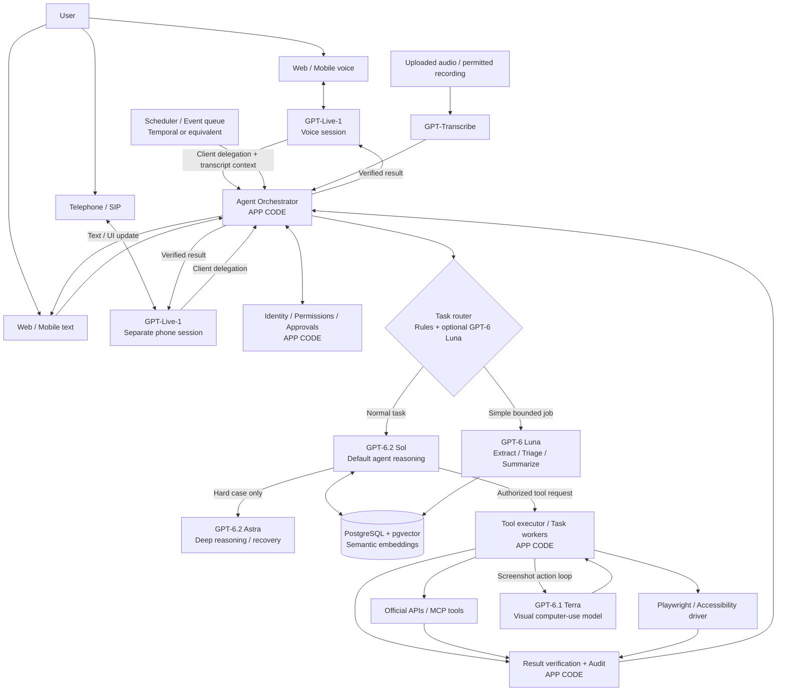

# Recommended Model Stack for a Pickle-Like AI Agent Service

**Architecture brief — November 19, 2026**  
**Target:** A commercial personal AI agent with text/voice interaction, phone calls, web and desktop actions, persistent memory, delegated research, and background task execution.  
**Approach:** OpenAI-first, but with provider-independent model interfaces and application-owned task state. This is a proposed architecture, **not** a claim about Pickle's internal implementation.

## Executive decision

**Launch with** `gpt-live-1` (voice), `gpt-6.2-sol` (main agent), `gpt-6-luna` (cheap bounded tasks), `gpt-6.1-terra` (visual computer use), `text-embedding-3-small` (memory retrieval), and a **non-model** orchestrator/policy engine. Add `gpt-6.2-astra` for hard escalations, `gpt-transcribe` for standalone audio transcription, and `omni-moderation-latest` for content-safety screening.

**Do not run every model on every request.** Model routing should be task-specific. A durable application orchestrator—not an LLM—must own workflow state, tool permissions, retries, cancellations, budgets, and action verification.

## 1. Where each model sits — at a glance

| Model | Architectural position | Primary job | When invoked | Why here (not elsewhere) |
|---|---|---|---|---|
| **`gpt-live-1`** | **Voice edge**, between a microphone/phone and the agent backend | Bidirectional speech, turn-taking, interruptions, conversational replies | During an active voice or SIP phone session | It natively accepts and emits audio; it is the *voice interface*, not the durable task owner |
| **`gpt-6-luna`** | **Lightweight backend utility worker**, optionally near task intake | Structured extraction, intent triage, message categorization, routine summaries, background checks | Only for cheap, bounded tasks for which deterministic rules are insufficient | Lower cost and overhead than the primary agent; avoid an unnecessary Luna call on every turn |
| **`gpt-6.2-sol`** | **Core agent reasoning worker** invoked by your orchestrator | Plan tasks, choose tools, interpret results, draft final responses, coordinate bounded steps | Default for most real-world agent tasks | Balanced capability/cost; separate from voice so it can keep working after disconnection |
| **`gpt-6.1-terra`** | **Computer-use specialist** inside an isolated browser/desktop worker | Interpret screenshots and choose mouse/keyboard actions | When API/DOM/accessibility automation cannot complete a permitted GUI task reliably | Model specializes in visual reasoning; the automation driver actually performs and verifies actions |
| **`gpt-6.2-astra`** | **Escalation / specialist reasoning worker**, behind the main agent | Deep investigation, difficult replanning, ambiguity resolution, demanding deliverables | Only when task complexity, evaluation failures, or budget policy justify escalation | Strong but expensive; should not run in the hot path for routine requests |
| **`text-embedding-3-small`** | **Memory indexing/retrieval service** alongside Postgres + pgvector | Turn consented notes and search queries into semantic vectors | At memory write time and for retrieval queries | Better for semantic recall than repeatedly feeding entire histories into the reasoning model |
| **`gpt-transcribe`** | **Asynchronous audio-processing worker**, *outside* the live speech loop | Audio-file and recording transcription; searchable meeting/call records | When users upload recordings or a separate transcript is needed | Do not put this in front of GPT-Live unless you intentionally choose a chained STT→LLM→TTS design |
| **`omni-moderation-latest`** | **Safety screening** around relevant text/image input/output | Flag content categories for review or policy handling | According to a risk-aware screening policy | Safety classifier, **not** a substitute for deterministic authorization or approval checks |

**Most important distinction:** The **agent orchestrator is software**, not one of the models. `gpt-6.2-sol` proposes plans and tool calls; your application executes only authorized calls and stores their outcomes.

## 2. Full model placement diagram



*The diagram is conceptual: `text-embedding-3-small` is called by the memory service to create vectors, not as a persistent model process inside PostgreSQL. Similarly, Terra produces action decisions; the driver performs the actual clicks and reads the resulting screen.*

## 3. Request paths: what actually runs

### A. Casual voice conversation

1. The app establishes a **WebRTC** connection to `gpt-live-1` (or SIP for phone calls).
2. The user speaks; GPT-Live listens and can respond in speech directly.
3. **No separate STT, TTS, Sol, Terra, or Astra invocation is required** for a simple conversational reply.
4. The application retains appropriate session context and transcript events; transcript text can be imperfect.

**Reason:** Keep natural conversations fast and avoid unnecessary per-turn API calls.

### B. Voice request that requires a tool

**Example:** “Check my calendar and move my meeting to Friday.”

1. `gpt-live-1` receives audio and delegates the action.
2. The application receives the delegation event and assembles the task from transcript events plus its own conversation state. **The delegation event itself is not the complete utterance.**
3. The **orchestrator** checks identity, tool scopes, confirmation policy, existing task versions, and idempotency.
4. `gpt-6.2-sol` interprets the request and prepares structured tool calls.
5. The app checks calendar availability and prepares the change using the authorized calendar API.
6. If approval is required, the app asks for confirmation **before** committing the change.
7. The application verifies the updated calendar state, stores the result, and returns a concise verified outcome to GPT-Live using the original delegation ID.
8. GPT-Live says the result aloud. **No separate TTS call.**

**Reason:** The language model can understand instructions; only the application can reliably enforce transaction boundaries and confirmed external state.

### C. Browser or desktop task

**Example:** “Complete this online form.”

1. `gpt-6.2-sol` decides which authorized tool can perform the step.
2. **First:** use an official API if available. **Second:** try Playwright / DOM / accessibility controls.
3. **Only when needed:** send screenshots and current UI state to `gpt-6.1-terra` for visual action selection.
4. The sandboxed automation driver executes each permitted click/keystroke and obtains the new state.
5. Validate completion from the website or application; request user approval before sensitive submissions.

**Reason:** Pure vision loops are more expensive and failure-prone than structured APIs. Terra is a fallback specialist, not a replacement for Playwright or safety controls.

### D. Long-running autonomous job

**Example:** “Research 20 competitors and prepare a report. Tell me when it’s finished.”

1. Text or voice intake creates a **durable task record** in Postgres/Temporal.
2. `gpt-6-luna` may classify the task or extract constraints if necessary; `gpt-6.2-sol` plans and executes the main workflow.
3. Specialist tool workers search, browse, retrieve documents, and assemble evidence. Escalate difficult reasoning portions to `gpt-6.2-astra` only if criteria are met.
4. Persist checkpoints and tool outputs. A disconnected voice session **does not own or cancel** a task by default.
5. On completion, a notification informs the user; if a live voice session exists, GPT-Live can speak the result.

**Reason:** A commercial assistant cannot depend on a live websocket session for durable jobs.

### E. Outbound phone call

1. The main agent creates a scoped call objective and seeks any required user authorization.
2. Telephony middleware connects the call using a permitted SIP provider, with a **separate GPT-Live session** handling live audio.
3. That phone agent can delegate factual lookups to the backend while it converses.
4. Store a verified call outcome. Record or transcribe calls only with applicable consent and legal compliance.
5. `gpt-transcribe` is **optional** when an independent audio-file transcript is genuinely needed; do not duplicate it by default.

**Reason:** Phone calls need their own lifecycle, disclosure/consent handling, retries, and audit trail—not just a tool call inside a text model.

## 4. Routing policy — avoid wasteful model chaining

| Incoming work | Default path | Escalation / specialist | Avoid |
|---|---|---|---|
| “Hello, how are you?” in voice | GPT-Live direct | None | Calling Sol for every greeting |
| “What does this short message mean?” | GPT-Live direct or Sol for text | Luna if doing high-volume classification | Three models for one simple answer |
| “Summarize these 100 notifications” | Luna worker | Sol if summaries require multi-source reasoning | Astra by default |
| “Schedule a meeting” | Sol + calendar tool | Astra only for genuinely complex constraints | GUI automation when an API exists |
| “Use a desktop app to fill this form” | Sol + authorized driver | Terra when screenshot-based reasoning is needed | Blind clicking without checking state |
| “Investigate a failed multi-step workflow” | Sol retry / replan | Astra for challenging recovery | Repeating possibly completed actions |
| “Search what I told you last month” | SQL + embedding retrieval | Sol for synthesis | Sending the entire conversation history |
| “Transcribe an uploaded Korean audio file” | GPT-Transcribe | Benchmark specialist ASR if needed | Launching a GPT-Live session only to transcribe a file |
| “Call a business on my behalf” | Sol scopes task → separate GPT-Live SIP session | Sol for tool lookups during call | Treating a phone call as one stateless request |

### Escalate to Astra only when one of these conditions holds

- A task is explicitly high-complexity or requires a demanding multi-stage professional deliverable.
- Evaluation or verification shows that Sol has failed a substantive reasoning step, not merely that an external website timed out.
- Multiple valid plans conflict and the choice has meaningful downstream cost or risk.
- A budget-limited review of Sol's plan would be more economical than continued retries.

**Do not use a model’s self-reported “confidence” as the only escalation signal.** Prefer observable errors, verification failures, fixed complexity categories, and per-task spend thresholds.

## 5. Memory, policy, and skills are not interchangeable with models

### Memory

- **Source of truth:** relational data in PostgreSQL (user settings, approved facts, permissions, reminders, task IDs).
- **Semantic recall:** consented textual memories embedded using `text-embedding-3-small` and indexed with pgvector; combine vector retrieval with keyword/SQL filters.
- **Memory writes:** use code plus Luna/Sol only when needed for extraction, with provenance and user controls; never assume every transcript fragment should become permanent memory.
- **Optional upgrade:** benchmark `text-embedding-3-large` for difficult Korean-English retrieval before adopting the additional cost.

### Permissions and safety

- **Moderation model:** `omni-moderation-latest` can screen selected text/image content.
- **Deterministic policy engine:** access control, allowed tools, spending caps, payment confirmation, sharing restrictions, booking approvals, and credential handling.
- **Verification:** confirm actual success from a returned tool result, database record, receipt, or observed UI state.
- **Security:** isolated browser sessions, least-privilege integration tokens, protected secrets, and action logs.

**Moderation is not transaction authorization.** A harmless-looking instruction can still require explicit user approval before spending money or changing account data.

### Tools and skills

- **Models:** choose an action, interpret data, or generate language.
- **Tools:** perform the action (calendar API, Gmail API, browser driver, terminal, CRM, etc.).
- **MCP:** one standardized interface for compatible tool integrations; it is not a model.
- **Skills:** reusable instructions/workflows for the agent or tool runtime; they are not running models.
- **Orchestrator:** application code that starts jobs, routes calls, enforces policy, manages retries, and tracks results.

## 6. Minimal first release vs scalable production version

| Layer | MVP | Scale-up |
|---|---|---|
| Voice | `gpt-live-1` | GPT-Live + SIP voice agents, interruption handling, observability |
| Text and planning | `gpt-6.2-sol` | Sol with optional Astra escalation |
| Cheap background utilities | Optional `gpt-6-luna` | Luna for high-volume triage/extraction and low-cost automations |
| Browser actions | Playwright first | Playwright + isolated computer-use workers with Terra |
| Memory | PostgreSQL | PostgreSQL + pgvector + consented embedding pipeline |
| Durable tasks | Postgres job table + worker | Temporal (or equivalent durable workflow engine) |
| Connectors | 2–3 direct official APIs | Permissioned integration registry + MCP where useful |
| Telephony | Not needed for first web MVP | SIP + isolated GPT-Live call sessions |
| Transcription | GPT-Live transcripts for voice UX | `gpt-transcribe` for uploads / consented recordings |
| Guardrails | Hardcoded scopes + approvals | Policy engine, moderation, tool audits, evaluation suite |

**Suggested MVP scope:** messages/calendar + browser administrative tasks + natural voice. Add purchasing, persistent proactive work, and outbound phone calls after action verification and authorization are reliable.

## 7. Model/runtime registry (illustrative configuration)

```yaml
models:
  voice_frontend: gpt-live-1
  default_agent: gpt-6.2-sol
  cheap_utility: gpt-6-luna
  computer_vision_agent: gpt-6.1-terra
  complex_reasoning_fallback: gpt-6.2-astra
  embeddings: text-embedding-3-small
  file_transcription: gpt-transcribe
  text_image_moderation: omni-moderation-latest

routing:
  default_task_model: default_agent
  classification: cheap_utility # only when a rules-based path is insufficient
  gui_visual_fallback: computer_vision_agent
  complex_recovery: complex_reasoning_fallback
  prefer_api_before_browser: true
  require_verified_action_results: true
  require_approval_for_consequential_actions: true
  do_not_repeat_unconfirmed_non_idempotent_actions: true

voice:
  transport: webrtc
  phone_transport: sip
  delegation: client # application owns tool policy, workflows, and task context
  external_stt_for_live_conversation: false
  external_tts_for_live_conversation: false

state:
  database: postgresql
  semantic_index: pgvector
  workflow_engine: temporal # or another durable queue/worker solution
```

This is **architecture configuration**, not a complete SDK-ready configuration file. Validate account access, model IDs, supported endpoints, and parameter compatibility at deployment time.

## 8. Approximate API model-cost reference

These are published **standard list rates** as checked on November 19, 2026; processing tiers, cache usage, tool calls, and provider contracts can change actual spend.

| Model | Published reference price | Cost implication |
|---|---|---|
| `gpt-live-1` | **$0.05 per active session minute**, plus backend/tool costs | Do not keep sessions open for unattended background work |
| `gpt-6-luna` | **$0.10 input / $0.50 output per 1M text tokens** | Cheapest routine text utility layer in this stack |
| `gpt-6.2-sol` | **$2 input / $10 output per 1M text tokens** | Default agent cost baseline |
| `gpt-6.1-terra` | **$1 input / $5 output per 1M text tokens** | Use selectively for screen-based actions |
| `gpt-6.2-astra` | **$8 input / $40 output per 1M text tokens** | Strict escalation and usage budgets |
| `text-embedding-3-small` | **$0.02 per 1M input tokens** | Low-cost semantic indexing and retrieval |
| `gpt-transcribe` | **$0.0045 per minute of audio** | Economical for standalone audio processing |

**Not included:** computer/tool call charges, web search, voice telephony/SIP costs, egress, databases, external integrations, cloud browsers, or workflow hosting. Recheck current pricing before setting customer plans.

## 9. Evaluation plan: the model stack is a hypothesis until tested

Test on realistic Korean and English tasks, including Korean–English code-switching:

1. **Voice:** time-to-first-audio, interruptions, Korean proper names, and naturalness.
2. **Task completion:** independently verified completion across email, calendar, shopping, booking, and browser flows.
3. **Computer use:** tool steps per successful task; screenshot tokens; recovery after UI changes.
4. **Memory:** recall accuracy with temporal corrections; cross-user isolation; deletion behavior.
5. **Long-running jobs:** crash/reconnect recovery, idempotency, and duplicate-action prevention.
6. **Economics:** model/tool spend per *successful* task rather than per conversation turn.
7. **Safety:** approval adherence, unauthorized-action rate, and audit completeness.

Prefer routing configurations that meet task-success thresholds at the lowest **all-in cost**, rather than blindly choosing the highest-capability model.

## 10. Official references

- [OpenAI model catalog](https://developers.openai.com/api/docs/models/all)
- [GPT-Live overview](https://developers.openai.com/api/docs/guides/live)
- [GPT-Live delegation and tools](https://developers.openai.com/api/docs/guides/live-delegation)
- [GPT-Live model](https://developers.openai.com/api/docs/models/gpt-live-1)
- [GPT-6.2 Sol model](https://developers.openai.com/api/docs/models/gpt-6.2-sol)
- [GPT-6 Luna model](https://developers.openai.com/api/docs/models/gpt-6-luna)
- [GPT-6.1 Terra model](https://developers.openai.com/api/docs/models/gpt-6.1-terra)
- [GPT-6.2 Astra model](https://developers.openai.com/api/docs/models/gpt-6.2-astra)
- [Computer use guide](https://developers.openai.com/api/docs/guides/tools-computer-use)
- [Telephony / SIP guide](https://developers.openai.com/api/docs/guides/voice-sip)
- [GPT-Transcribe model](https://developers.openai.com/api/docs/models/gpt-transcribe)
- [Embeddings guide](https://developers.openai.com/api/docs/guides/embeddings)
- [Moderation model](https://developers.openai.com/api/docs/models/omni-moderation-latest)

---

**Bottom line:** `gpt-live-1` is the **voice front door**; `gpt-6.2-sol` is the **default reasoning engine**; `gpt-6-luna` is the **cheap utility worker**; `gpt-6.1-terra` is the **visual GUI specialist**; `gpt-6.2-astra` is the **expensive expert fallback**; embeddings, transcription, and moderation are **specialized supporting services**. The **code-based orchestrator** makes the whole product dependable.
