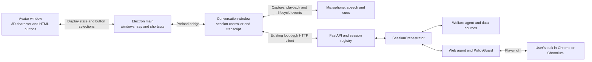

# Implementing Cheongeum’s desktop avatar

**Architecture proposal · 19 November 2026.** Keep one running conversation and add a second Electron window for the avatar and its quick choices. Opening the conversation reveals the window that already owns the active session. A person can ask a question by voice, choose an action beside the avatar, and open the transcript halfway through the same task. [Approved UI design](../specs/2026-11-19-avatar-assistant-ui.md)

## Components and ownership



| Component | Exists today | Proposed responsibility |
| --- | --- | --- |
| Electron main and preload | Start Python, wait for health, create the conversation window, and relay the global Talk shortcut. The default desktop mode hides this window and provides a tray menu. | Create the overlay after the controller is ready. Handle placement, showing the conversation, the tray and keyboard entry into the choices. Relay messages between the two identified windows. [Shell](../../../apps/desktop/main.cjs) · [Preload](../../../apps/desktop/preload.cjs) |
| Conversation window | `app.js` starts the session, holds UI state, appends transcript entries to the DOM, polls progress and handles consent, Stop, confirmation and recovery. `api.js` owns the writer credential and request counter. | Keep this renderer alive while hidden. Extract a small controller interface around those existing handlers. Both windows dispatch to it. Move focus and text-field clearing into the surface that initiated the interaction. [Application](../../../src/cheongeum/web/static/app.js) · [HTTP client](../../../src/cheongeum/web/static/api.js) |
| Avatar window | Proposed. | Load a dedicated static page with a labeled avatar button, Talk control, mic status and a quick-choice card. It subscribes to display state. Activating the avatar opens the conversation. Selecting a quick choice leaves the card interaction on the desktop. |
| Voice and animation | The renderer has a hands-free voice loop, one-shot recording, browser dictation, server and browser speech output, and sound cues. | Keep audio acquisition and playback in the controller window. Send the avatar capture and playback transitions. Render a still pose when idle or motion is reduced. An unavailable model falls back to an image with the same HTML controls. [Microphone](../../../src/cheongeum/web/static/mic.js) · [Playback and cues](../../../src/cheongeum/web/static/speaker.js) |
| Backend and task browser | FastAPI creates a session through `AgentRuntime`. The orchestrator routes welfare questions to the welfare agent and web tasks through the web agent, policy checks and Playwright. The work page lives in a separate browser. | Python owns the meaning and validity of a task action. The overlay receives the outcome through the controller. Keep page observation, permissions, approval checks and handoff verification on their existing paths. [Runtime wiring](../../../src/cheongeum/server/runtime.py) · [Orchestrator](../../../src/cheongeum/orchestrator/session.py) · [Turn result types](../../../src/cheongeum/core/turn.py) |

The ordinary web UI uses the same controller directly. Only Electron installs the window bridge. Loading the existing app entry point in the avatar would run session creation again, attach another voice loop when invoked, and make its page lifecycle responsible for a different session. Give the overlay its own entry point.

### One request, end to end

On the practice site, the user presses **말하기** and asks Cheongeum to fill the name field. The controller records one utterance and sends it to FastAPI. Python transcribes it, observes the form, and returns a turn with a pending field-entry approval. The controller speaks the review once and gives the overlay a card for that decision. When the user selects **입력 승인**, the controller sends the captured action ID. The backend rechecks the field, performs the permitted write and reports the result. Clicking the avatar afterward reveals the conversation that recorded both turns. A changed field sends the user back to review.

## What crosses the desktop bridge

The controller publishes a small display snapshot on meaningful changes. The main process forwards the latest snapshot when the overlay reports ready, including after an overlay reload. The example below is a **proposed desktop message** for a login handoff.

```json
{
  "revision": 32,
  "mode": "auth-handoff",
  "capture": "off",
  "speaking": false,
  "lang": "ko",
  "prompt": "복지로에서 직접 로그인해 주세요.",
  "choiceSetId": "card-7",
  "choices": [
    { "key": "auth-done", "label": "로그인했어요" },
    { "key": "auth-cancel", "label": "인증 취소" }
  ]
}
```

- **Render.** Use a monotonically increasing revision per controller instance to order snapshots. Give each distinct decision an opaque choice-set ID, unique across owner restarts. Playback or progress updates can change the revision while keeping the same choices. The overlay returns only the choice-set ID and selected key. The controller retains the server-side references that identify the decision.
- **Dispatch.** Validate the sender, current set, allowed key, busy state and session generation. Consume a selection synchronously before awaiting HTTP so a spoken answer and a double-click cannot both dispatch the same decision. Bind the voice turn to the decision present at capture start. A changed decision prompts a fresh selection. Stop remains available during a pending request.
- **Display data.** Use localized status strings, safe site labels, and known action labels. Keep field values, filenames, typed text, raw audio, full observations, transcripts and recovery credentials in their existing owners. If an approval needs private details to be understood, offer **내용 확인** to open the existing review panel or let the user deliberately hear the details before approving. Render labels with text nodes.
- **Desktop permissions.** Use a dedicated overlay preload and isolated Electron session. Restrict overlay requests to its bundled static assets and give microphone access to the identified controller window. Today the shell checks the app origin for media permission, so a second same-origin page needs an explicit window boundary. Expose named bridge methods and deliver only their payloads. [Existing permission handlers](../../../apps/desktop/main.cjs) · [Electron IPC](https://www.electronjs.org/docs/latest/tutorial/ipc) · [Electron context isolation](https://www.electronjs.org/docs/latest/tutorial/context-isolation)

## How user actions reach the backend

| Interaction | Implementation path |
| --- | --- |
| Start, decline, or accept consent | The controller runs `chooseSession` and `connect` once. Route consent through `POST /api/session/{sid}/consent`. Today desktop startup reads the consent prompt and accepting starts hands-free speech. Label that effect explicitly. During consent, provide a visible decline action and the keyboard equivalent. Preserve the existing text-only welfare route after decline. |
| Ask by voice or text | For server STT, the controller sends recorded audio to `POST /api/audio/turn?sessionId=…`. Typed input and supported browser dictation use `POST /api/turn`. Both reach `handle_turn`. Apply each accepted result once, append its redacted user utterance and reply to the conversation, then publish the safe avatar state. Answer text, source and date belong in the expanded view. |
| Speak the reply | The controller uses `POST /api/audio/speak` when server TTS is available, with the existing browser synthesis fallback. Publish actual playback start, end, interruption and failure. Use those events to move the avatar’s mouth. A network request for speech can precede audible playback. Capture may also be active during playback for interruptions or claps, so derive mic state from track and recognition lifecycles independently of the speaking pose. |
| Show work in progress or stop | Reuse the controller’s busy-time poll of `GET /api/session/{sid}/progress` and its `seq`, `running` and `latest` fields. Route a deliberate Stop from either surface or the tray through `stopAll` and `POST /api/session/{sid}/cancel`. The existing busy-time voice path uses `POST /api/audio/stop?sessionId=…`. On a recognized Stop, apply its returned result and invalidate pending UI work. Local capture and speech stop immediately. Report backend completion after acknowledgment. |
| Approve or reject a specific action | Use `POST /api/session/{sid}/confirm` with `{approve, actionId}`. Capture the exact `pendingConfirmation.actionId` when the card is displayed. Extend the current `confirm(approve)` wrapper to accept that captured ID for both surfaces. Recheck it before dispatch and retain the backend’s stale-ID and page-fingerprint checks. Preserve distinctions such as field entry, file transfer and practice submission. The current **수정하기** control focuses the text input for practice submission. Other correction flows need explicit support before displaying that button. |
| Return from login | Today the full window sends **다 했어** or **인증 취소** through `/api/turn`. The orchestrator routes completion to `auth_done`, which observes the browser, checks the active gate and expected origin/path, and resumes the pending task when appropriate. In the overlay, bind Done and Cancel to the specific `authHandoff.id` using the proposed choice contract below. Handoff takes priority over ordinary suggestions. Release microphone tracks and dictation before showing **마이크 꺼짐**. |
| Hide, open conversation, or end the session | Hide and open are native window operations. The desktop owner stays loaded, with its current transcript, pending decision and heartbeat. Explicit **이용 종료** calls the existing `endSession` and `DELETE /api/session/{sid}`, clears the overlay and releases media. The overlay must never run the owner’s `pagehide` detach/close handler. |

Current routes and return shapes are defined in the [FastAPI handlers](../../../src/cheongeum/server/app.py), [frontend HTTP client](../../../src/cheongeum/web/static/api.js), [progress model](../../../src/cheongeum/core/progress.py), [approval recheck](../../../src/cheongeum/agents/web/approval.py) and [browser handoff logic](../../../src/cheongeum/agents/web/skills/browse.py).

## Backend addition for contextual buttons

Approvals already have a machine-readable action ID. General suggestions are a different case. For example, `answerCard.nextAction` is display text, and `observation.fields` can include values. Neither provides an executable list of permitted choices. The first slice can deliver Talk, Stop, conversation opening and existing structured approvals with the current HTTP API. For contextual page actions and handoff buttons, add one optional result field and one scoped route.

1. Add an optional `offeredChoices` list to `TurnResult`, defaulting to empty for older responses. Generate up to three stable keys from the current domain state when finishing an actionable turn. Initial keys could include `read-main`, `start-guided-fill`, `auth-done` and `auth-cancel`. Localize labels and accepted spoken phrases from the same catalog. Offer **본문 읽기** where the backend can read the main content. Reserve **신청 방법 읽기** for a source that identifies that section. Offer guided entry only when the page and policy support the first prompt.
2. Introduce `POST /api/session/{sid}/choice`. For a handoff the body is, for example, `{"turnId":"turn-17","key":"auth-done","handoffId":"handoff-3"}`. These IDs are illustrative. Store the active offer and its page or handoff context with the session. Use existing writer validation and request-ledger handling. Inside the session queue, verify the offer, re-observe the page when its identity or capabilities matter, then dispatch through the same guarded domain routine used by speech. Perform validation and consumption in the same queued operation. Reuse the internal handler there so dispatch acquires the session lock once.
3. A successful selection returns the usual `TurnResult`. An expired offer returns a typed conflict with no side effect. Remove the old card, announce that the options changed and provide a way to ask for current options. The existing approval route continues to handle consequential actions. Spoken approvals retain their action-ID binding and normal confirmation rules. A number or generic acknowledgment must never approve a newly displayed request.
4. Invalidate offers when a competing user turn supersedes the decision, the page or handoff changes, or the session stops, detaches, expires or ends. Bind IDs into the idempotency payload so a retry of the same request can return its original result. A client receiving a result without `offeredChoices` still has Talk, Stop and the current conversation. [Turn schema and normalization](../../../src/cheongeum/core/turn.py) · [Session queue and turn finalization](../../../src/cheongeum/orchestrator/session.py) · [Request ledger](../../../src/cheongeum/server/recovery.py)

## Window and session lifecycle

- **Opening and focus.** A passive avatar card can appear while the user types in Chrome. Only a deliberate click on the avatar, a tray command or the choices shortcut requests focus. In companion mode, closing the expanded window hides it. Keep the standalone web page’s current close behavior. Publish one accessibility announcement per event and retain keyboard access to unresolved decisions. Test the browser’s focused field before and after the card appears.
- **Cancellation and stale results.** The controller owns the HTTP request sequence and retry headers. Snapshot both the session generation and the Stop generation for each pending operation, including audio, confirmations and progress. Discard late results, errors and playback callbacks after a generation change. The orchestrator already advances its epoch and aborts on Stop. If cancellation fails, distinguish **음성 입력 중지됨** from the still-unconfirmed browser task and offer a retry.
- **Reload and disconnect.** On overlay loss, clear its controls and request a new snapshot from the live controller when it returns. On controller loss, disable actions, clear the main process’s cached snapshot and announce the connection loss. Use the existing same-tab recovery flow when available for an opted-in personal profile. The server rotates writer credentials and the controller asks before resume. A checkpoint restores eligible task context with the mic off and requires a fresh approval. Shared or unidentified profiles start fresh on loss. A Python process restart loses its in-memory session. [Recovery implementation](../../../src/cheongeum/server/recovery.py) · [Recovery UI](../../../src/cheongeum/web/static/app.js)
- **Packaging.** A practical location for the avatar page, a locally bundled Three.js module, the GLB and the still image is the existing FastAPI static directory. The overlay may load these assets even while disconnected from a task. Preserve the desktop content security policy and include any new preload in the Electron builder file list. Verify installed asset paths and Python runtime discovery separately from a repository launch. [Static asset mount](../../../src/cheongeum/server/app.py) · [Desktop packaging](../../../apps/desktop/electron-builder.yml)

## Delivery order and verification

| Slice | Deliverable | Acceptance check |
| --- | --- | --- |
| 1. Connect a still avatar | Dedicated overlay page, main-process bridge, controller snapshot, Talk, Stop and open-conversation actions. | Start from the tray, speak, open the transcript and close it three times. Observe one session creation, one active voice controller, one heartbeat loop and a single copy of the user message and reply. |
| 2. Share existing decisions | Project eligible approval summaries, bind both surfaces to the displayed action ID and route requests through the same controller. | Deliver two clicks and a spoken approval against a synthetic field. At most one write succeeds. Replace the field or decision and activate the old button. It performs zero writes. |
| 3. Add contextual choices and handoff | Add the scoped backend contract, localized labels, stale-choice handling and login return. | Run a practice form to a simulated login. An unchanged gate stays waiting. The expected return page resumes the original task. A superseded handoff ID or changed page produces zero actions. Complete the path by keyboard with the conversation collapsed. |
| 4. Add motion and exercise desktop behavior | Connect the GLB to actual playback, provide a still fallback and package both windows. | Interrupt playback mid-sentence and check that motion ends. Confirm mic state during interruption and login, focus retention under NVDA on Windows, monitor changes, reduced motion, and the keyboard path with VoiceOver on macOS. |

The existing suite exercises individual backend and web UI behaviors. Desktop IPC, native focus, the proposed choice endpoint and avatar animation need their own checks as those pieces land. Existing coverage includes [stale approvals in the web UI](../../../tests/e2e/test_web_ui.py), [Stop during navigation](../../../tests/e2e/test_stop_inflight.py), [recovery and retry](../../../tests/e2e/test_pilot_recovery.py), and [handoff completion, cancellation and expiry](../../../tests/e2e/test_conversation.py).

**Verified on 19 November 2026.** Twenty existing tests passed against the local synthetic fixtures. Sixteen covered approval fingerprints, recovery and retry, in-flight Stop, public pages with login controls, and the web UI’s stale field approval. Four handoff tests covered an unchanged gate, resuming the pending form, checking the expected return page, and expiry, cancellation or browser loss. These results establish the integration baseline for the proposed desktop work.
