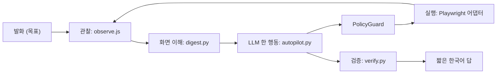

# Navigating agent for 청음: research and plan

Date: 2026-11-17.

This document merges two sources in this folder into one.

- `navigating agent.md` is a survey of AI agents that operate graphical interfaces. It is called "the survey" below.
- `navigating agent - fit for cheongeum.md` is the analysis of the 청음 codebase and a live probe of public sites. It is called "the probe" below.

It answers one question. How should 청음 get better at working through websites, and later desktop apps, for a blind user who speaks Korean to it?

## 1. Verdict

The survey describes agents that look at screenshots and click pixel coordinates. 청음 should not move to that design. It already runs the same observe, decide, act, re-observe loop, but on DOM text, with actions addressed by role and name. That is the right base for this product, because the safety gate judges every click by its role and name, and a coordinate has neither.

The largest wins are not the survey's headline techniques. The probe shows that the autopilot loses most of its ground before the model is asked anything. On the 복지로 home page the model is offered 12 buttons, all of them utility buttons, while the main menu buttons are observed and then cut. Fixing what the model is shown comes first. Reporting what each action did comes second. Vision and desktop apps come after that.

## 2. How to read the evidence

| Kind | Meaning |
|---|---|
| Measured | Counted by a probe script on 2026-11-17. Headless Chromium, locale `ko-KR`, viewport 1100 by 860, one read-only visit per page. Scripts are in `research results/probes/`. |
| Read from code | Follows from the cited file and line. Not run. |
| From the survey | Stated in `navigating agent.md`. The survey names its sources but gives no links. |
| Not verified | Could not be confirmed in this session. |

Run a probe from the repository root:

```bash
uv run python "research results/probes/probe_gaps.py"            # what observe.js sees and misses, per site
uv run python "research results/probes/digest_check.py" <url>    # which items reach the autopilot model
uv run python "research results/probes/drill_anchors.py" <url>   # markup of anchors without href
```

### Reliability of the survey

Use the survey for general techniques. Treat its product claims with care.

- The figures for OpenAI's Computer-Using Agent (38.1% OSWorld, 58.1% WebArena, 87% WebVoyager), Claude 3.5 Sonnet (14.9% to 22.0% OSWorld), and UI-TARS (24.6% OSWorld at 50 steps) match what those teams announced, as far as I recall. They were not re-checked against the original pages in this session.
- "OpenAI Dots", "Grok Bot", and "SillyAgent" are not verified.
- One entry is wrong. The survey says Claude's computer use was "fine-tuned GPT-3.5". Claude is Anthropic's own model family.

## 3. The loop, in the survey and in 청음

The survey's core picture is a loop: perceive the screen, reason about the next step, act, observe the result, repeat. 청음 has that loop today.



1. `observe.js` runs in the page and returns fields, links, buttons, headings, dialogs, and up to 4,000 characters of main text.
2. `digest.py` shortens that. `digest_for_llm` passes at most 30 content links, 12 menu links, and 12 buttons (`src/cheongeum/agents/web/digest.py:188-199`).
3. `autopilot.py` asks the model for one action per step out of `open_url`, `click`, `search`, `back`, `read_more`, `answer`, `ask_user`, `fail`. The budget is 10 steps and 75 seconds.
4. `WebExecutionAgent._run` sends every action through `PolicyGuard.check` before the adapter runs it (`src/cheongeum/agents/web/agent.py:322`).
5. Answers are checked against the text of the pages seen in this run (`src/cheongeum/safety/verify.py`).

## 4. Topic by topic

Each topic gives what the survey says, where 청음 stands, and what to take.

### 4.1 Perception

**Survey.** All the surveyed agents take screenshots. Web agents may add the DOM or the accessibility tree. Desktop agents may query OS accessibility APIs.

**청음.** Perception is DOM text only. The model is text-only (`src/cheongeum/core/llm.py:81`). There is no screenshot anywhere in `src/`.

**Take.** Keep structured text as the main sense. It is cheaper, it is what a screen reader user's world is made of, and it gives the guard names to judge. Add a screenshot only as a fallback reader (stage 3).

### 4.2 Grounding

**Survey.** Grounding maps an instruction to an on-screen target. Options are a direct coordinate from the model, a detector that proposes elements, OCR, and DOM or accessibility queries where the model picks an element by ID.

**청음.** The model retypes an item's name, and `follow_link` matches the name against observed links and buttons. Several matches end the step without a click (`src/cheongeum/agents/web/autopilot.py:256`).

**Take.** Element IDs. Give each interactive element a ref, and let the model answer with a ref. `observe.js` already stamps `data-cheongeum-id` on fields (`observe.js:10-14`). Reject coordinate output. The action contract excludes it on purpose (`src/cheongeum/core/actions.py:47`).

### 4.3 Action execution

**Survey.** Browser automation through Playwright or the DevTools protocol, or OS input through PyAutoGUI and accessibility APIs.

**청음.** Playwright, with accessibility-first locators (label, then role and name, then test ID). Already aligned.

**Take.** Nothing for the web. For desktop apps, use accessibility APIs, not simulated mouse input (stage 4).

### 4.4 Decision and planning

**Survey.** The model reasons step by step over recent screenshots and past actions, breaks tasks into subgoals, and falls back to the user for sensitive steps.

**청음.** One action per step with a one-sentence thought and a step history. Sensitive steps are handed to the user by `safety/gates.py` and `guard.py`.

**Take.** Better feedback into the history. Today a step is "성공" or "실패" with a note. The model needs to know what changed.

### 4.5 Failure and recovery

**Survey.** Common failures are clicks with no effect, loops, layout changes, and injected instructions in page text. Mitigations are effect checks, step limits, and treating page text as data.

**청음.** Step and time limits exist. The same action a third time stops the run. Page text is untrusted. One gap remains. `follow_link` waits up to 6 seconds for the URL or title to change and then returns `ok` either way (`src/cheongeum/agents/web/agent.py:164-167`). A click on a tab stalls for 6 seconds and is recorded as a successful move. This is read from code.

**Take.** The effect check (stage 2).

### 4.6 Training

**Survey.** Imitation learning on demonstration traces, reinforcement learning on task reward, fine-tuning of vision-language models, and very large compute.

**청음.** Uses hosted and local models as they are.

**Take.** Nothing. This is a different kind of project.

### 4.7 Evaluation

**Survey.** OSWorld for desktop tasks, WebArena and WebVoyager for the web, scored by task success.

**청음.** `scripts/eval_agent.py` runs ten goal tasks on the mock portal and on real Korean sites and compares models. The planning summary reports 9 of 10 for the OpenAI model and 3 to 5 of 10 for local Qwen 7B (`docs/기획요약.md:36`). Scoring is keyword-based.

**Take.** The method, not the benchmarks. Add tasks on the sites 청음 users need, written to fail for the reasons the probe measured (stage 0).

### 4.8 Security and privacy

**Survey.** User confirmation before sensitive actions, scope limits, local versus cloud processing, action logs, and an off switch.

**청음.** All present: PolicyGuard tiers, consent and stop gates, redaction before any text is used, de-identified events, and an immediate stop.

**Take.** Carry the same rules into the new parts. Vision output is untrusted text. Screenshots can contain what the user typed, so input fields are masked before capture.

### 4.9 Data model

**Survey.** Tasks decompose into steps, and each step has a screenshot and an action.

**청음.** `AutopilotResult` already holds `steps` and `actions`, and events are de-identified.

**Take.** Nothing new. Screenshots are not stored.

## 5. What the probe measured

| Page | Seen by observe | Measured gap |
|---|---|---|
| 복지로 home | 2 links, 40 buttons (the cap) | 12 of 40 buttons reach the model. Not sent: 복지서비스, 서비스신청, 복지위기알림, 복지지도. 9 clickable `div`s with no role are not observed. |
| 복지로 service detail | 2 links, 24 buttons | 12 of 24 buttons reach the model. 3 anchors with `role="link"` and no `href` are not observed. 6 clickable `div`s are not observed. The page has no `<main>` and one usable heading. |
| 정부24 | 0 links, 0 buttons | Redirected to a bot wall (`plus.gov.kr/mbuster`). Not a perception problem. 청음 reports it and does not bypass it. |
| 홈택스 | 43 links, 11 buttons, 8 fields | 1 anchor without `href`. Small gap on the landing page. |
| 국민연금 | 6 links, 1 button | Redirected to a gate page. Small gap. |
| 보건복지부 | 84 links, 28 buttons | 2 image-only links dropped. 17 expandable controls observed without their open or closed state. One cross-origin news widget in an iframe holds 2,413 characters. |
| 건강보험 | 98 links, 40 buttons (the cap), 23 fields | 6 image-only links dropped. 2 tabs built as `li` are not observed, and their hidden panel holds 718 characters. |
| 네이버 | 129 links, 20 buttons | 28 image-only links dropped. 14 tabs observed as plain links, so the model cannot tell they are tabs. |
| 네이버 뉴스 | 524 links (300 kept), 40 buttons (the cap), 45 fields | Visible text is 17,075 characters and `mainText` keeps 4,000. `read_more` pages only through those 4,000. |

What the numbers say:

- **Truncation is the first problem.** On 복지로, menus are buttons. The first 12 buttons in DOM order are "본문 바로가기", "공동인증서 내보내기", "지원", "작게", "크게", "로그인" and similar. The autopilot prompt tells the model it can only click names in the list, so it cannot choose 복지서비스 on the product's main target site.
- **Names are lost cheaply.** `linkName` in `observe.js:79` ignores `img alt`. A link that contains only an image has an empty name and is dropped. Every image-only link in the sample had alt text, so no vision model is needed to recover them.
- **Role and state are lost.** Tabs and expanders are mostly real links or buttons, so they are observed. `role="tab"`, `aria-selected`, and `aria-expanded` are not reported.
- **Iframes and shadow DOM matter less than expected.** No sampled page used shadow DOM. Child frames were banners, ads, and one news widget.
- **`mainText` may include hidden text.** On 보건복지부 and 건강보험, `mainText` is longer than the visible body text. It is built from `textContent` of a clone (`observe.js:110`), which includes text inside `display:none` elements. Not investigated further.

Limits of the sample: nine pages, mostly landing pages, one visit each, no login. Deep pages of 홈택스 or 정부24 were not sampled and may use iframes more.

## 6. Plan

The survey ends with an eight-milestone roadmap for building an agent from nothing. 청음 is not starting from nothing, so the milestones map onto five stages.

| Survey milestone | Stage here |
|---|---|
| 1. Planning and evaluation setup | Stage 0 |
| 2. Perception prototype | Stage 1. Perception exists and is extended. |
| 3. LLM integration | Exists. Stage 3 adds image input. |
| 4. Action execution layer | Exists. Stage 4 adds a second adapter. |
| 5. Iteration and state tracking | Stage 2 |
| 6. Training and refinement | Not adopted |
| 7. Evaluation and benchmarking | Stage 0, rerun after each stage |
| 8. Scaling and optimization | Existing step and time limits, and the digest that shrinks model input |

### Stage 0. Measure first

Add tasks to `scripts/eval_agent.py` that fail today for the measured reasons. Examples are a 복지로 task that needs the 복지서비스 menu, a task whose answer sits behind a tab, a task whose answer sits past 4,000 characters, and a task that needs an image-only link. Add tab, expander, and image-link fixtures to the mock site so the unit and e2e suites cover them without the network. The mock site has none today.

### Stage 1. Show the model the right things

No new model and no new dependency.

1. **Rank instead of cut.** Replace `d.buttons[:12]` with a selection that drops utility buttons (font size, skip links, language, social, footer) and keeps navigation buttons. Where links are scarce and buttons are many, give buttons the link budget.
2. **Recover names.** Use `img alt` in `linkName`. Observe `[role="link"]` anchors without `href`.
3. **One interactive list with refs.** Each entry carries a ref, a role (link, button, tab, menu item), a name, and its state (selected, expanded, disabled). The model answers with a ref and the adapter resolves it to one element. `PolicyGuard` still receives role and name.
4. **Clickable elements without a role.** Observe them so the page description is complete. They are not clickable by the agent. See the decision in section 7.
5. **Raise or page the caps.** `mainText` 4,000 characters, 300 links, 40 buttons.

Alternative for item 3: Playwright's `aria_snapshot()` returns a YAML tree of roles, names, and states. It exists in the installed version (1.65.2, checked by import). An issue on playwright-python reports that the Python API lacks the `ref` option of the Node API. Without refs the snapshot cannot be mapped back to elements, so extending `observe.js` is the lower-risk path. A short prototype can confirm this.

### Stage 2. Tell the model what its action did

1. **Effect check.** Compare the observation before and after each click: URL, title, main text, dialogs, and the clicked element's state. Report "moved", "changed in place", or "no visible change" in the step history. Stop waiting 6 seconds when the change is in place.
2. **New moves.** `scroll` for lazy-loaded lists. The adapter supports it (`src/cheongeum/agents/web/browser/__init__.py:257`) and the autopilot does not offer it. Tab selection and expand follow from stage 1.
3. **Guard rule.** Add tabs and expanders to what `_check_read_only` allows, under the same risky-name rule as buttons (`src/cheongeum/safety/guard.py:142-148`).

### Stage 3. Vision as a fallback reader

1. **Plumbing.** `generate` accepts an optional image and sends it as an image part in the OpenAI-compatible message.
2. **When.** Only when the digest is thin, when an image has no alt text and sits where content should be, or when the user asks for a screen description.
3. **Marks, not coordinates.** Draw the stage 1 refs on the screenshot as numbered marks and ask the model about the marks. This is Set-of-Mark prompting. The answer names a ref, so the action stays element-addressed.
4. **Rules that must hold.** Vision output is untrusted text and never becomes an instruction. `verify.py` compares against DOM text, so a number read from an image cannot be checked. Such answers are labelled as read from an image, or withheld.
5. **Privacy.** Mask input fields before capture. Playwright's `screenshot(mask=...)` exists in the installed version.
6. **Cost.** One extra model call when triggered. Local Qwen 7B is text-only, so a vision-capable model is needed.

### Stage 4. Desktop apps

1. **Shape.** A second `ExecutionAdapter` over Windows UI Automation. `ExecutionAdapter` is already platform-neutral (`src/cheongeum/core/actions.py:182`). UIA exposes the role-and-name tree that screen readers use, and control patterns map onto existing action types: Invoke for `click`, Value for `fill` and `read`, Toggle for `check`, ExpandCollapse for menus.
2. **Library.** `pywinauto` with `backend="uia"` wraps patterns behind control methods. The `uiautomation` package exposes pattern objects directly. Either adds a Windows-only dependency.
3. **Design work first.** `PolicyGuard` tiers by URL origin (`guard.py:70-78`). Apps need their own allowlist, for example by process and window, and their own read-only tier. `Platform` is `Literal["pc"]` and `Observation` requires a `url`.
4. **Recommendation.** A throwaway prototype on one harmless app, after stages 1 and 2 land. Certificate and login windows stay with the user, as on the web. The planning summary's expansion path is more public websites (`docs/기획요약.md:32`), so this stage is a scope decision.

### Not adopted

| Idea from the survey | Reason |
|---|---|
| Coordinate clicks | No role or name for the guard to judge. Excluded by the action contract. |
| Training, fine-tuning, reinforcement learning | 청음 uses existing models. |
| OSWorld, WebArena, WebVoyager | They do not measure Korean public sites or voice use. |
| Memory of learned procedures | Site knowledge belongs in `SiteProfile`. Self-written procedures would be a second, unreviewed source. |
| Long runs (hundreds of steps) | A listening user needs a short answer or an honest failure. The 10-step, 75-second budget stays. |

## 7. Decisions

Decided on 2026-11-17:

- **Guard rule on read-only sites.** Tabs and expanders may be clicked when their name is not on the risky list. Clickable elements with no role stay blocked. They are observed and can be described, and the agent does not click them.

Open:

1. Which stages to build. Recommended: 0, 1, 2 now. Stage 3 after the eval shows what remains. Stage 4 as a prototype only.
2. For stage 3, whether screenshots may be sent to a hosted model with input fields masked, or vision must stay local.
3. For stage 4, whether desktop apps are in scope, and which app the prototype targets.

## 8. External sources

Each link was returned by a search in this session.

- Set-of-Mark prompting: [arXiv 2310.11441](https://arxiv.org/abs/2310.11441).
- Playwright Python aria snapshots: [guide](https://playwright.dev/python/docs/aria-snapshots), [Locator API](https://playwright.dev/python/docs/api/class-locator), [release notes](https://playwright.dev/python/docs/release-notes). The missing `ref` option is reported in playwright-python issue 2826. It was seen through a mirror and not confirmed as still open.
- Windows UI Automation: [control types and supported patterns](https://learn.microsoft.com/en-us/windows/win32/winauto/uiauto-controlpatternmapping), [pywinauto getting started](https://pywinauto.readthedocs.io/en/latest/getting_started.html).
- DOM lists versus screenshots as agent input: [webfuse comparison](https://www.webfuse.com/blog/dom-snapshots-vs-screenshots-as-web-agent-context). Search results on this topic were blogs and vendor posts that disagreed on details of browser-use. They support the general tradeoff only.
