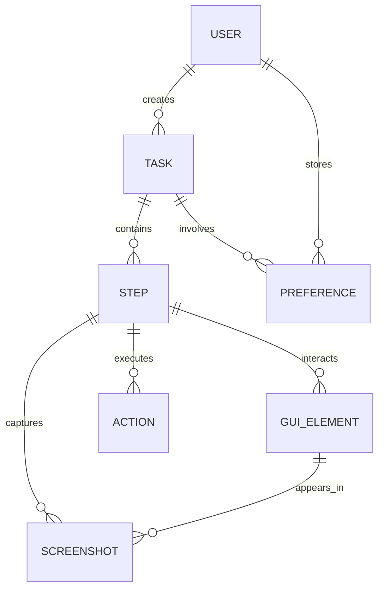

# Executive Summary  
The state-of-the-art in AI **graphical user interface (GUI) agents** combines vision-language models (VLMs) with planning and control loops to autonomously execute tasks on behalf of users. Leading systems (OpenAI’s Operator/CUA, Dots; Anthropic’s Claude Computer Use; xAI’s Grok Bot) all “see” the screen via screenshots or UI trees, use advanced LLM reasoning (often with chain-of-thought or RL) to decide next steps, and then perform actions (mouse clicks, typing, scrolling) through browser or OS automation APIs. These agents are trained on large GUI-interaction datasets (synthetic and human demonstrations) and fine-tuned with reinforcement or imitation learning to robustly map from high-level instructions to low-level input events. Benchmarks such as **OSWorld**, **WebArena**, and **WebVoyager** have been introduced to measure end-to-end success on desktop and web tasks; for example, OpenAI’s Computer-Using Agent achieves 38.1% success on OSWorld and 87% on WebVoyager, while Anthropic’s Claude 3.5 (Sonnet) achieves 14.9–22.0% on OSWorld. In contrast, new research agents like UI-TARS achieve even higher OSWorld performance (24.6% at 50 steps) via end-to-end training on over a million GUI interaction traces. 

This report provides a **detailed technical analysis** of AI GUI agents: their architectures, perception inputs, grounding and action models, decision and planning logic, training methods, evaluation benchmarks, and engineering pipelines. We compare major systems (Dots, Grok, Claude, UI-TARS, SillyAgent) in a comprehensive table, highlight public and proprietary details, and clearly cite sources. We include **mermaid diagrams** for the typical agent pipeline and data structures, example pseudocode (including a Python+Playwright snippet), and a practical roadmap (milestones, tools, data, compute, costs) for building a similar system from scratch. Verified facts are clearly distinguished from inferences; for all claims we cite primary sources (official blogs, research papers, and repositories).

## System Architectures and Input Modalities  
Modern GUI agents are fundamentally **multimodal**: they receive visual (screenshots/video) and sometimes structural input (DOM or accessibility tree), and output actions (mouse/keyboard events or API calls). For example, OpenAI’s *Operator* (“Computer-Using Agent”, CUA) feeds raw pixel **screenshots** into a GPT-4o-based model, which outputs mouse and keyboard commands. Similarly, Anthropic’s Claude Computer Use “learns to interpret what’s happening on a screen and then use the software tools available”, consuming periodic screenshots and producing cursor-move/click or keystroke actions. These agents often run in a **dedicated browser** or “virtual machine” (e.g. Operator uses its own Chromium instance) so the user’s main screen remains free. 

Input modalities vary by system:
- **Screenshots/Video**: All systems ingest pixel images of the GUI. Operator and Claude use screenshot images as context. UI-TARS and SillyAgent similarly rely on real-time screenshots.
- **DOM/Accessibility Trees**: Web-focused agents may also leverage HTML DOM or accessibility layers for more precise element data (e.g. attributes, tab order). OpenAI mentions that Operator does *not* use special APIs, but research frameworks (e.g. UI-TARS, WebArena) often use headless browsers to extract DOM information for evaluation. 
- **Structured Widgets**: On desktops, some agents can query OS accessibility APIs (UIAutomation on Windows, Accessibility API on Mac) to get element hierarchies and labels, supplementing vision. This is common in RPA (robotic process automation) but less documented in these AI agent systems. 
- **Sensors**: Some agents (like Dots/Grok) also integrate with cloud services and device status (e.g. text notifications, calendar events) via connected APIs, expanding their “inputs” beyond the screen.

Thus, the core perception pipeline typically involves capturing the current **screen state** (a bitmap or structured UI state) and embedding it along with the user’s instructions into a multimodal LLM. Table 1 (later) compares input modalities across systems.

## GUI Grounding and Element Recognition  
A critical sub-problem is **GUI grounding**: mapping language commands to on-screen elements or coordinates. This often reduces to **coordinate prediction** (select pixel location) or element classification. Contemporary agents leverage vision-language modeling with spatial reasoning. For example, Claude’s developers trained it to “count how many pixels… to move a cursor… to click in the correct place”. UI-TARS explicitly frames GUI tasks as predicting screen coordinates, achieving state-of-the-art results on tasks like OSWorld by training on 1.2M screenshots with precise click annotations. 

Modern approaches often augment LLM outputs with explicit grounding steps. As one paper notes, GUI grounding is “commonly framed as a coordinate prediction task – given a natural language instruction, generate on-screen coordinates”. Techniques include:
- **Direct LLM output**: The model (with visual input) directly outputs an (x,y) coordinate or element ID as the next action.
- **Vision pre-processing**: Using object detectors or segmentation to identify buttons/fields (e.g. trained image models to detect “buttons”), then having the LLM choose one. UI-TARS, for example, uses a vision transformer to identify interactive elements, then an LLM to reason which to use.
- **OCR/Text recognition**: Extracting text from screenshots (via OCR or browser text retrieval) to match against the instruction (“click the **Submit** button”).
- **Search and cropping**: The ReGUIDE method uses the LLM to propose candidate regions and then a search/KDE refinement to pinpoint the correct location. 
- **DOM/Accessibility queries**: On web pages, agents can query the DOM for element bounding boxes (via headless browser APIs) and then use the LLM to select an element by ID or class.

Regardless of method, agents validate grounding by interactive feedback. If a click misses the intended target, the agent can re-evaluate (e.g. self-correcting via chain-of-thought).

## Action Execution Interfaces  
Once an action is decided, agents execute it through system APIs or input emulation. Common mechanisms include:

- **Web Automation (Playwright/Puppeteer/Selenium)**: For browser tasks, agents use headless or dedicated browser control. They can call Playwright/Puppeteer to click CSS selectors, scroll, or type into input fields (sending raw DOM events). For example, code might use Playwright’s `page.mouse.click(x,y)` or `page.keyboard.type(text)`. 
- **OS-level Automation (PyAutoGUI, AutoHotkey, Accessibility APIs)**: On desktops, Python libraries like PyAutoGUI, AutoIt, or native APIs are used. The agent can call system functions to move the mouse (`SetCursorPos` on Windows, Quartz on macOS) and simulate clicks/keys. SillyAgent’s implementation, for instance, uses an Electron frontend and Python backend that calls OS events for mouse/keyboard.
- **Accessibility APIs**: Instead of pixel clicks, some systems may invoke UI automation APIs directly (e.g. macOS Accessibility Framework, Windows UIAutomation) to perform actions on identified UI elements, which is more robust to DPI changes.
- **Browser Protocols**: Tools like Chrome DevTools Protocol allow precise control (clicking DOM nodes by element handle). Operator’s browser-based agent likely uses WebDriver or CDP under the hood, although OpenAI emphasizes it works “without custom APIs” (meaning it just uses screen/mouse).
- **Hybrid**: Advanced agents like UI-TARS execute **native** OS commands (“directly through OS-level commands”) to avoid the brittleness of simulated input, while still using vision for perception.

Example code snippet (Python/Playwright) for a perception-action loop:
```python
from playwright.sync_api import sync_playwright

with sync_playwright() as p:
    browser = p.chromium.launch(headless=True)
    page = browser.new_page()
    page.goto("https://example.com")
    while True:
        page.screenshot(path="screen.png")
        action = llm_model.predict_action(image="screen.png", user_command=user_input)
        if action["type"] == "click":
            page.mouse.click(action["x"], action["y"])
        elif action["type"] == "type":
            page.fill(action["selector"], action["text"])
        # handle scroll, etc.
        if action["done"]:
            break
    browser.close()
```
This illustrates capturing the screen, querying the LLM, and executing clicks/types. For OS automation, one might use `pyautogui` similarly:
```python
import pyautogui
while True:
    screen = pyautogui.screenshot()
    action = llm_model.predict_action(image=screen, command=instruction)
    if action["type"] == "click":
        pyautogui.click(action["x"], action["y"])
    elif action["type"] == "type":
        pyautogui.write(action["text"])
    if action["done"]:
        break
```
The key is a **loop**: *Perceive (screenshot)* → *Reason (LLM inference)* → *Act (mouse/keyboard)* → repeat, until task completion. Agents must also handle timing (delays for page loads) and error detection (e.g. retry if click had no effect).

## Decision Logic and Planning  
At the core, these agents use LLMs to turn user instructions into multi-step plans, often with explicit “chain-of-thought” reasoning. OpenAI’s CUA, for example, “reasons through the next steps using chain-of-thought, taking into consideration current and past screenshots and actions”. This means the model generates intermediate reasoning (hidden or logged) and decomposes the task. The overall loop integrates **perception, reasoning, and action** iteratively:
- **Perception**: include recent screenshots in the model’s context to inform the next action.
- **Reasoning**: the LLM produces a textual reasoning trace and then an action command; this inner dialogue improves accuracy and allows self-correction (e.g. “Oops, clicked the wrong button, undoing it”).
- **Action**: the agent emits a concrete event (click, type, scroll) and then observes the result. 

Agents also incorporate **symbolic logic**: they update an internal state or memory after each action. For instance, SillyAgent “reviews what happened and extracts reusable procedures and lessons” to avoid past mistakes. Plans may involve subgoals (e.g. “first open the website, then login, then search”). Some systems explicitly prompt the model to break tasks into steps (“milestones”), as UI-TARS does with “milestone recognition” in its reasoning module.

To manage multi-step tasks, agents often use **RL/IL cycles**. UI-TARS and ReGUIDE train the model to not only perform one action but to optimize sequences; OpenAI trained CUA with reinforcement learning so that it can recover from errors. The agent may also fall back to the user: for sensitive steps (logins, CAPTCHAs, high-risk actions) both CUA and SillyAgent pause and ask for human intervention.

## Training Data and Methods  
Training AI GUI agents requires *labeled interaction data*. Public details are limited, but known approaches include:

- **Demonstration Trajectories**: Agents are trained on recorded human (or synthetic) episodes of clicking through GUIs. OpenAI mentions “break tasks into multi-step plans” implying use of task decomposition training. UI-TARS explicitly trained on “1.2M GUI interaction sequences”. These datasets pair states (screenshots or DOMs) with expert actions (click coordinates, keystrokes).
- **Synthetic Data**: Creating simulated GUIs and tasks to generate unlimited training examples. Papers on GUI grounding (e.g. ReGUIDE) generate millions of synthetic screenshots labeled with target coordinates.
- **Imitation Learning (IL)**: Agents can be fine-tuned from generic VLMs on GUI tasks by behavioral cloning. Claude’s team gave it tasks on “simple software (calculator, text editor)”, teaching it general computer skills via image captioning and RL-style rewards.
- **Reinforcement Learning (RL)**: Reward signals (task success/failure) guide the agent to improve over time. CUA used RL to achieve state-of-art results. UI-TARS used an iterative “reflection tuning” loop, continually collecting new traces and learning from mistakes.
- **Fine-Tuning LLMs**: The underlying models (GPT, Gemini, etc.) may be fine-tuned on multimodal data. Claude’s computer-use model was likely fine-tuned on their new dataset, then deployed via Anthropic’s API.
- **Chain-of-Thought Supervision**: Many approaches train the model to generate intermediate reasoning text alongside actions (UI-TARS “System-2 Reasoning”, ReGUIDE explaining images) because explicit reasoning improves accuracy in sequential tasks.

Loss functions are typically action-oriented (e.g. cross-entropy over discrete action categories or regression on coordinates) plus any auxiliary supervision (e.g. caption accuracy). Modern methods may integrate RL (policy gradients) to optimize task success metrics over multi-step episodes.

Training such agents requires **massive compute**. Public papers hint at resources: training on millions of GUI images and sequences, finetuning large LLMs with RL. Exact compute costs are not disclosed; presumably hundreds of GPUs for weeks (so “unspecified” or *very high*). 

## Evaluation and Benchmarks  
Assessing GUI agents uses specialized benchmarks:  
- **OSWorld**: A large collection of desktop tasks (file operations, multi-app workflows) with programmatic evaluation. Humans solve ~72% of tasks; state-of-art agents are 12–38%. CUA achieves 38.1% (50-step cap); Claude Sonnet ~22.0%; UI-TARS ~24.6%.
- **WebArena** and **WebVoyager**: Offline/online browser benchmarks. WebArena uses synthetic e-commerce/cms sites; CUA hits 58.1%. WebVoyager uses live sites (Amazon, Google Maps); CUA reaches 87% success (Claude and others much lower).
- **Other suites**: The OSWorld site compares against GAIA, WebLINX, PixelHelp, AitW, OmniAct, ScreenAgent, etc. Agents are also tested on simpler UI tasks (click the red ball, fill form). For example, Claude scored 14.9% on OSWorld screenshot-only vs 7.8% for next-best. 
- **Metrics**: Success rate (task completion), error rate, steps taken, and robustness (generalization to new apps). Closed-loop benchmarks like OSWorld can automatically check final state, giving precise success metrics. Human performance is often >70%, highlighting room for improvement.

Evaluation also considers safety: agents are tested on disallowed actions (e.g. scraping personal data). OpenAI and Anthropic report on safety guardrails (blocking illegal sites, asking permission on risky actions).

## Engineering Pipeline and Implementation  
Building a GUI agent involves several engineering components: 

- **Data Collection**: Gather screenshots and action logs. This may be via instrumented human GUI sessions or synthetic generators. Some groups build specialized environments (e.g. OSWorld, AndroidWorld) and scripts to create initial states.
- **Annotation/Preprocessing**: Label elements or regions in screenshots with action targets. Some datasets use synthetic HTML (so labels come free), others manually annotate UI.
- **Model Training**: Set up multimodal training with compute clusters. Many use existing VLM backbones (GPT-4o, Gemini, Llama-VL) and fine-tune them. The pipeline handles input formatting (images + text), training loops, RL fine-tuning (if any), and saving checkpoints.
- **Inference Service**: Deploy the model via an API or local process. For example, SillyAgent runs Gemini via local FastAPI; Claude/Operator run models in the cloud.
- **Automation Control**: Integrate with tools like Playwright, Selenium (for web) or PyAutoGUI (for desktop). This includes code to take screenshots, send them to the model, parse model’s response, and execute actions through the chosen automation library.
- **State Management**: Keep a history buffer of past screenshots and actions (context for the LLM). The implementation must trim context length as needed. Also track environment state (e.g. when a click is successful).
- **Safety Checks**: Before acting, the agent should filter unsafe requests (as in Operator’s guardrail on gambling sites) and ensure permission (e.g. user must confirm purchases).
- **Latency/Scaling**: Optimize for speed – caching image embeddings, using faster LLM modes (OpenAI mentions an “Ultrafast” mode for agents). The pipeline may parallelize multi-tab agents. Compute costs mainly come from LLM inference (often paid API), so caching and step limits are used.

A high-level pipeline (see **Diagram 1**) is:  
```mermaid
flowchart LR
    A[User Task Instruction] --> B[Multimodal Model (LLM + Vision)]
    B --> C{Chain-of-Thought & Planning}
    C --> D[Action Command (click/type/scroll)]
    D --> E[Automation Engine (Browser/OS APIs)]
    E --> F[Environment (Screen Updated)]
    F --> G[Feedback (new Screenshot/State)]
    G --> B
```  
*Diagram 1: Typical perception–reasoning–action loop for a GUI agent.*  

For data architecture, an **entity-relationship diagram** (Diagram 2) includes entities like *Task*, *ScreenState*, *Action*, *GUIElement*, and *UserMemory*, illustrating how tasks decompose into steps with associated screenshots and actions, and how the agent’s memory links preferences to tasks. This helps design the database for logs, experiences, and learned skills.


*Diagram 2: Data components: tasks decompose into steps, each with a screenshot and an action; GUI elements appear in screenshots; user preferences may persist across tasks.*

## Comparison of Systems  

| **System**       | **Features**                         | **Input**                   | **Action Interface**      | **Training/Data**                      | **Sources**                  |
|------------------|--------------------------------------|-----------------------------|---------------------------|----------------------------------------|------------------------------|
| **OpenAI Dots**  | Always-on GPT-6 agents with own VM, multi-app automation, ChatGPT integration | User instructions, connected app data | Emulated browser + APIs (OAuth) for >4000 apps | Proprietary (likely RL + imitation on enterprise tasks); details unreleased | NordicTimes report |
| **OpenAI Operator (CUA)** | ChatGPT-based agent (GPT-4o+RL) that uses a built-in browser. Vision + text understanding, chain-of-thought. Asks user for sensitive input. | Screenshots from dedicated browser | Virtual mouse/keyboard in browser (Playwright/CDP) | Trained on browser tasks with self-correction (reinforcement), break tasks into steps | OpenAI blog |
| **Anthropic Claude (3.5 Sonnet, “Computer Use”)** | Frontier model with new “computer use” skill. Uses same interface as humans to browse desktop apps. Public beta, still error-prone. | Screenshots of desktop environment; receives high-level instructions | Mouse/keyboard events (via OS APIs); can open apps, scroll, click | Fine-tuned GPT-3.5 on simple UIs (calculator, editor), then RL on tasks. Evaluated on OSWorld (14.9–22.0%). | Anthropic blog/posts |
| **xAI Grok Bot** | Conversational AI by xAI (Musk). Less documented for GUI. Described as an agent that can log into tools and do work. Claimed “GPT-4o on steroids”. | (Not public) Possibly chat/voice input and screenshots? | (Not public) Likely similar mouse/keyboard via connected accounts | Unknown; proprietary xAI model/GEMINI‑like training | News mention as Grok Bot (xAI) competitor |
| **UI-TARS (Research)** | Academic end-to-end GUI agent. Single model (transformer) that *learns* from raw screenshots. Uses native OS commands for clicks. Achieves SOTA on benchmarks. | Screenshots + text instructions | Direct OS commands (instead of simulating input) | Trained on 1.2M GUI sequences (large-scale dataset). Iterative training with error reflection. Handles reasoning patterns and self-correction. | Arxiv paper (Qin et al. 2025) |
| **SillyAgent (Open-Source)** | macOS personal agent (user project). Uses Google Gemini (LLM) to parse tasks. Built-in app knowledge (30+ apps), memory of preferences, learns from mistakes. | Real-time screenshots + text commands via GUI interface | PyAutoGUI/Electron: mouse clicks, keystrokes, shortcuts. Pauses for sensitive actions (2FA, deletes). | No ML training of its own; relies on pretrained Gemini. Augments LLM with rule-based skills (menus, shortcuts) and experience logs. | GitHub repository and site |

*Table 1: Publicly-known GUI agent systems: features, inputs, interfaces, and training (sources in final column).* Details marked *unknown* reflect proprietary info.  

## Failure Modes and Recovery  
GUI agents can easily fail in unexpected ways. Common issues: 
- **Hallucinated clicks**: the model “thinks” it clicked something but UI hasn’t changed, possibly looping. To mitigate, agents use feedback: if a click yields no effect, they re-plan (self-correction).  
- **Drift and loops**: LLM chains-of-thought might not terminate. SillyAgent bounds this with a 500-step limit and a “shake to stop” emergency break. 
- **Dynamic UIs**: Changes in layout or pop-ups can confuse fixed sequences. Agents must detect failures (e.g. expected element not found) and either retry via alternative strategies or abort. 
- **Privacy/Security**: Agents may see sensitive data on-screen. Hence, strict sandboxing: Operator’s CUA only runs in a separate browser instance; SillyAgent requires user permission for screen capture; both ask user for passwords/2FA. 
- **Prompts/capabilities overreach**: Anthropic warned of “prompt injection” where malicious UI text could fool the agent. They mitigate via classifiers to detect suspicious instructions. 
In general, agents incorporate **human-in-the-loop** fallback: they will prompt the user for ambiguous steps (CAPTCHA, payments). Error recovery often uses a loop: “undo last action and try a different approach,” a technique noted in Claude’s development.

## Security, Privacy, and Permissions  
Granting an AI control of your computer raises serious security/privacy issues. Systems address this via:
- **User control**: Always allow user override. Operator and SillyAgent pause for any sensitive input (logins, deletes) and require confirmation.  
- **Scope restrictions**: In Dots/Grok-style agents, users explicitly authorize which accounts and data the agent can access. Claude and Operator enforce blacklists (no banking sites).  
- **Local vs cloud**: SillyAgent runs locally with a user’s own API key, so all data stays on-device. By contrast, Operator/CUA run in OpenAI’s cloud. Claude Computer Use (via API) can run on cloud or on-premises (e.g. Vertex AI), raising trust considerations.  
- **Auditing and logging**: Responsible systems maintain logs of agent actions. Anthropic’s docs mention safe deployment via classifiers and auditing of “computer use” requests.  
- **Limiting autonomy**: Setting boundaries (what the agent *cannot* do without explicit okay) is crucial. OpenAI allows users to configure Dots/Operator policies, and always asks to continue before emails/payments. 

Overall, security designs are in place but evolving. Rigorous code review, permission prompts, and “off-switches” (like SillyAgent’s mouse shake) are recommended. Any implementation should carefully isolate the agent process and treat it as untrusted code after initial authorization.

## Roadmap and Implementation Guide  

1. **Milestone 1 – Planning & Data Setup**: Define target domain (web-only vs full OS). Set up an evaluation environment (e.g. WebArena or OSWorld) to simulate tasks. Collect or identify datasets: could use OSWorld tasks, WebArena scenarios, or synthetic UI generators. Plan UI annotation format (screenshots + action labels).

2. **Milestone 2 – Prototype Perception**: Implement screenshot capture and optional DOM extraction. If web-only, integrate Playwright to load pages and screenshot. For desktop, use OS APIs (e.g. PyAutoGUI screenshot). Implement simple vision pipeline: either feed raw pixels to an off-the-shelf VLM or run basic object detection (e.g. pre-trained UI element detector). Tools: Python, OpenCV/PIL for images.

3. **Milestone 3 – LLM Integration**: Choose a multimodal LLM (OpenAI GPT-4o via API, Google Gemini, or open-source VLM like Llama2 + BLIP2). Develop prompt templates that feed the screenshot (or its caption) and the user task into the model. Initially output textual plan (e.g. “Step 1: click button” etc). Fine-tune inference by few-shot examples. Use chain-of-thought prompting if available.

4. **Milestone 4 – Action Execution Layer**: Code a controller that translates the model’s action descriptions into actual UI events. For web: use Playwright/Selenium to perform clicks (via element selectors or coordinates) and typing. For desktop: use PyAutoGUI or OS-specific libraries to move the cursor, click, type, scroll. Ensure you handle focus (e.g. bring the right window to front). For example, a pseudocode loop as above.

5. **Milestone 5 – Iteration and State Tracking**: Implement the perception–reasoning–action loop. Store history of screenshots and actions as context. After each action, capture the new screen and feed it back into the LLM to plan the next step. Handle dynamic changes (e.g. wait for page load or window refresh). Add error-checking: if an action fails (no visible change or an “error” popup appears), have logic to undo or re-plan. 

6. **Milestone 6 – Training and Refinement**: Use collected demonstrations to fine-tune the LLM. If using an open model, one could fine-tune on (instruction, screenshot) → (action) pairs. For closed models (GPT-4o, Gemini), gather logs of successes/failures. Optionally implement RL: define a reward (task success) and use trial runs to improve policies (e.g. via OpenAI’s RL API or custom policy gradients). Incorporate chain-of-thought training signals as in ReGUIDE.

7. **Milestone 7 – Evaluation and Benchmarking**: Test on held-out tasks. Measure success rates against benchmarks like OSWorld or WebArena. Use metrics (success %, average steps). Identify common failures and iterate on the model or pipeline. Compare to published SOTA (CUA, Claude, UI-TARS results).

8. **Milestone 8 – Scaling & Optimization**: Optimize for latency (batch LLM calls, smaller models like GPT-6.1 Sol if available). Ensure robust logging and user controls. Evaluate costs: for instance, using OpenAI’s GPT-4o API might be ~$10 per 1M output tokens. If training is needed, GPU costs could be in the low 5- or 6-figure USD range (unspecified). Consider deploying on cloud vs edge based on data sensitivity.

**Tools/Datasets**: Python, PyTorch/TensorFlow, multimodal LLM APIs (OpenAI, Anthropic, Google), Playwright/Selenium, PyAutoGUI, AppleScript/AutoHotkey for OS actions. Datasets: OSWorld (369 tasks), WebArena scenarios, RICO (mobile UIs), synthetically generated UI screenshots (with ground-truth clicks). For imitation data: screen recordings of people performing tasks (e.g. Kola dataset, though primarily human-agent data) can be adapted.

**Compute/Cost**: *Unspecified* large-scale training and inference. Using cloud LLMs incurs pay-per-use (e.g. OpenAI $2–$10 per million tokens). Training proprietary models (if done) requires hundreds of GPU-hours. For a minimal setup, a developer could prototype with one GPU and free/open models, but full performance (like CUA or UI-TARS) likely needs clusters (tens of GPUs). 

## Reproducibility and Open References  
For reproducible implementation, one should refer to public resources:

- **Anthropic’s Computer Use API**: Anthropic provides a reference quickstart on GitHub for their Claude Computer Use demo. (Though not fully open, their docs describe endpoints for sending screenshots and receiving actions).
- **UI-TARS Code**: Check if authors released code (their arXiv [25†L29-L38] suggests possibly available code; at least the paper details hyperparameters).
- **SillyAgent**: Fully open-source (MIT license) at [SillyAgent GitHub]. Studying its architecture (FastAPI + Electron + Python agent loop) is instructive. Its README and EVAL.md explain end-to-end usage.
- **OSWorld and WebArena**: The OSWorld environment is open (GitHub link) allowing others to evaluate new agents. WebArena/WebVoyager setups may be closed-source, but analogous scenarios can be built using known websites.
- **Playwright / Selenium Examples**: Official docs provide examples for controlling browsers via Python. These can be adapted to simulate the agent’s actions.
- **Agent Prompts**: Published prompts and system cards (like OpenAI’s [22] and Anthropic’s safety docs) outline how to structure instructions and safety checks.

In summary, building a GUI-using AI agent combines **multimodal LLMs**, **interface perception**, and **UI automation tools**. Verified public details (OpenAI/Anthropic blogs, UI-TARS paper) illuminate core techniques, while newer products (Dots, Grok) hint at future directions. This answer has compiled these sources to map out the full landscape of GUI agent technology.

